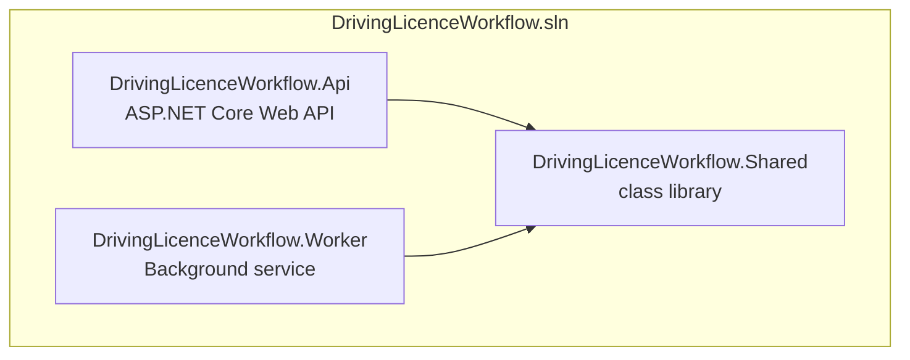
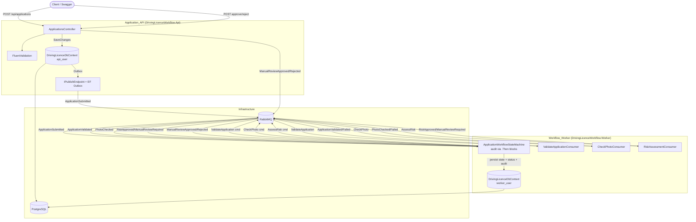
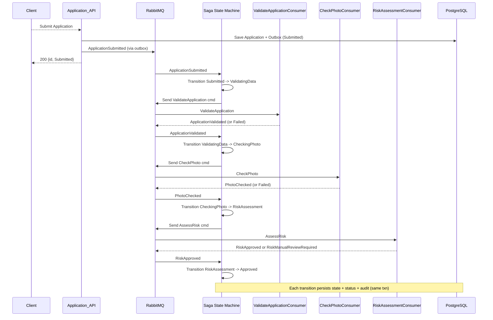
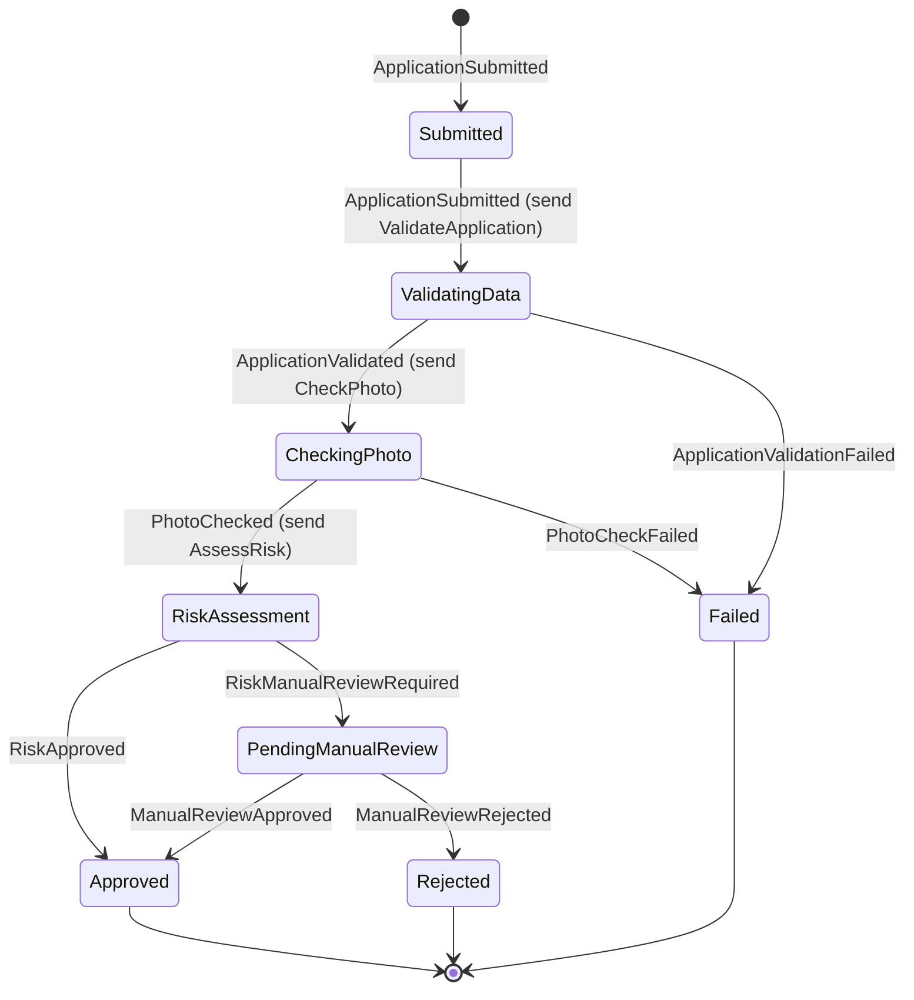
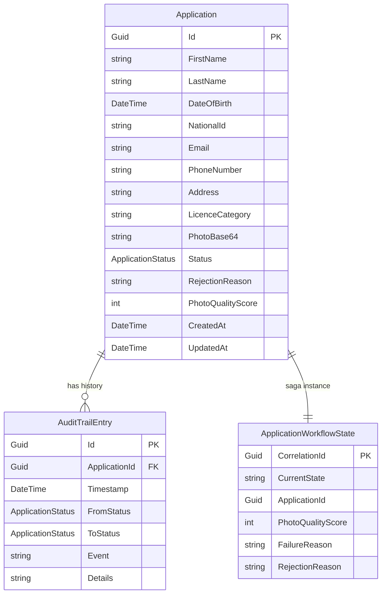

# Design Document

## Overview

The Driving Licence Onboarding Workflow System (DloWkf) is a backend system built in .NET 8+ that processes citizen applications for driving licences through a multi-state asynchronous workflow. A citizen submits an application with personal details and a face photo via an ASP.NET Core Web API. The API persists the application to PostgreSQL, publishes a message to a RabbitMQ queue, and an orchestration saga hosted in a background worker processes the application through data validation, a simulated photo check, and risk assessment. Every workflow transition is recorded in an append-only audit trail.

The workflow is implemented as a MassTransit orchestration saga using Automatonymous. The saga owns the state machine and coordinates step consumers that each perform a single workflow step. This design replaces the custom state machine approach noted in the requirements document; the trade-offs are documented below. The system is scoped for implementation within a fixed 6-hour window. Core functionality and architecture are prioritized; reliability hardening and bonus features are implemented or documented according to the time budget.

### Design Decisions and Trade-offs

The following architectural decisions are locked and override the requirements document where applicable.

**1. Workflow: MassTransit Saga (Automatonymous) instead of a custom state machine.**
The requirements document listed a custom state machine as the chosen approach. This has been changed to a full orchestration saga using MassTransit with Automatonymous. The saga state machine defines eight states and nine valid transitions, sends commands to step consumers, and listens for completion events. Each step (data validation, photo check, risk assessment) is a separate consumer that is independently retryable and fault-isolated. Automatic idempotency comes from state guards: a duplicate `ApplicationSubmitted` message arriving when the saga has already transitioned past `Submitted` has no handler in the current state and is silently ignored.
- **Rationale**: Step-level fault isolation, independently testable steps, native retry/dead-letter support, and a clear extensibility path for future async steps. MassTransit's test harness enables saga testing without a real broker.
- **Trade-off**: More moving parts than a custom state machine (saga instance, step consumers, message contracts). The saga must persist its state and handle crash recovery. A pure custom state machine would be less code but gives no built-in retry, idempotency, or broker integration.

**2. Photo Handling: Base64 payload in JSON body.**
The face photo is accepted as a base64-encoded string within the JSON request body.
- **Rationale**: Simplifies the endpoint, request validation, and testing. No separate upload state to manage.
- **Trade-off**: Base64 encoding adds ~33% size overhead and increases request body size and memory pressure. Acceptable for a simulated system with small photos; a production system handling large images would prefer multipart upload or a dedicated streaming endpoint.

**3. Queue: RabbitMQ with MassTransit.**
MassTransit is used as the .NET transport abstraction over RabbitMQ, providing consumer registration, retry policies with exponential backoff, dead-letter/error queue support, and message serialization.
- **Rationale**: Reduces boilerplate and provides production-grade reliability features (retry, DLQ) as one-line configuration.
- **Trade-off**: Adds an abstraction layer with its own configuration model. A system needing only raw pub/sub could use the RabbitMQ client directly.

**4. Database: PostgreSQL with EF Core and a single shared DbContext.**
One `DbContext` class (`DrivingLicenceDbContext`) maps all entities: `Application`, `AuditTrailEntry`, `ApplicationWorkflowState`, and the MassTransit outbox/inbox tables. The same `DbContext` class is used by both the API and Worker projects, but each project registers it with a different connection string using a different database user/credentials:
1. API: connection string uses `api_user`.
2. Worker: connection string uses `worker_user`.
- **Rationale**: Simpler — one `DbContext`, one set of migrations. Least privilege is still enforced via different database users/roles at the PostgreSQL level. The API's database user only has access to what it needs; the Worker's database user has access to what it needs.
- **Trade-off**: Both projects share the same `DbContext` class, so any schema change affects both. But since they target the same database, this is correct.

**5. Outbox Pattern: Implemented via MassTransit EF Core outbox.**
MassTransit's `UseEntityFrameworkOutbox<TDbContext>()` wraps `SaveChangesAsync` so the database write and the message publish are in the same transaction. A built-in background dispatcher reads the outbox table and delivers messages to the broker. This is used by the API when publishing `ApplicationSubmitted` and by the saga when publishing commands to step consumers.
- **Rationale**: Eliminates the "saved but not published" dual-write failure mode with zero custom dispatcher code.
- **Trade-off**: Slightly more infrastructure (outbox table, dispatcher background service) but the MassTransit implementation is built-in.

**6. Status Sync: Saga updates both saga state and denormalized application status.**
The saga updates `ApplicationWorkflowState.CurrentState` (its internal state) and `Application.Status` (a denormalized view for API reads) in the same transaction. The GET status endpoint reads directly from the `Applications` table with no joins.
- **Rationale**: Keeps reads simple and fast while the saga remains the source of truth for workflow logic.
- **Trade-off**: Two writes per transition, kept consistent within one transaction.

**7. Manual Review: API publishes events; saga owns transitions.**
The API endpoints check a precondition (status must be `PendingManualReview`, otherwise return 409) and then publish `ManualReviewApproved` or `ManualReviewRejected` events. The saga consumes these events, validates the transition, updates status, and records audit. The API returns 200 immediately after publishing.
- **Rationale**: Keeps transition logic in one place (the saga) and avoids the API writing workflow state directly.
- **Trade-off**: Eventual consistency. If the worker is down, the event sits in RabbitMQ until recovery. A client may briefly see the old status. This is correct for most cases. If the worker is down, the client sees a stale status until the worker recovers and processes the event.

**8. Audit Trail: IAuditService called directly from saga `.Then()` blocks.**
An `IAuditService` interface lives in the Shared library. The saga calls `IAuditService.RecordTransitionAsync()` directly from `.Then()` blocks after each transition. The `.Then()` blocks therefore contain both workflow state changes (for example, storing `PhotoQualityScore` on the saga instance) and audit recording calls.
- **Rationale**: More direct and easier to implement within the time budget. The audit call is explicit at each transition, making it easy to follow and test.
- **Trade-off**: The saga definition mixes workflow logic with cross-cutting concerns (audit). A cleaner separation of concerns is possible via a MassTransit pipeline observer that automatically detects state changes — this is documented as an enhancement below.

**9. Structured Logging: Serilog with file sink only.**
Both the API and Worker projects use Serilog as the logging provider, writing structured JSON logs to files only (no console sink, no other sinks). The log file path is configurable via `appsettings.json` / environment variables. Serilog's destructuring produces JSON documents with properties like `ApplicationId`, `State`, `Event`, and `Timestamp`, enabling structured queries over the log files.
- **Rationale**: The assignment requires structured logging across both the Application_API and the Workflow_Worker. Serilog is the de-facto .NET structured logging library and integrates cleanly with ASP.NET Core and MassTransit. A file sink keeps the local development setup dependency-free (no external logging service to run) while still producing machine-parseable structured logs.
- **Trade-off**: A file sink only is simple for local development but does not scale to multi-instance production where logs must be aggregated. Production would use a centralized logging system (ELK, Datadog, Seq, etc.) via the same Serilog pipeline by swapping the sink. File-based logging also requires log rotation to avoid unbounded growth; Serilog's rolling file sink handles this.

## Architecture

### Solution Structure

The solution is organized into three projects. The Shared library contains everything the API and Worker have in common; each executable project depends on it.



### Shared Library (`DrivingLicenceWorkflow.Shared`)

Contains domain models (including the persisted `ApplicationWorkflowState` saga instance), message contracts, the `DbContext` definition, business rule service interfaces and implementations, the `IAuditService` interface, and configuration option classes. The library provides reusable rule implementations; each host registers only the services it consumes. The API uses `IDataValidationService` during request validation. The Worker uses all three services in its workflow consumers.

The saga state machine is Worker orchestration and belongs in `DrivingLicenceWorkflow.Worker`, not Shared. The current implementation is temporarily in Shared; Task 15 tracks moving it and its direct test references to Worker while keeping the saga persistence model, message contracts, and shared service abstractions in Shared. This avoids making Shared responsible for host-specific orchestration while preserving the types required by both hosts and EF persistence.

### API Project (`DrivingLicenceWorkflow.Api`)

An ASP.NET Core Web API. Hosts controllers (`ApplicationsController`), FluentValidation request validators, MassTransit publisher configuration, `DrivingLicenceDbContext` registration (with the `AppDb` connection string) with EF Core outbox, and Swagger/OpenAPI documentation.

### Worker Project (`DrivingLicenceWorkflow.Worker`)

A hosted background service. Owns the MassTransit saga state machine and hosts it with `AddSagaStateMachine`, along with the step consumers (`ValidateApplicationConsumer`, `CheckPhotoConsumer`, `RiskAssessmentConsumer`), `DrivingLicenceDbContext` registration (with the `WorkerDb` connection string) with EF Core outbox, retry and dead-letter queue configuration, and the saga EF Core persistence repository. Audit recording is performed directly in the saga's `.Then()` blocks (see the State Machine and Audit Recording sections). Until Task 15 is implemented, the state machine source file remains in Shared.

### High-Level Architecture

The diagram below shows the runtime components, the message flow, and the two database contexts.



### Saga Orchestration Flow

The saga is the central orchestrator. It does not perform business logic itself; it sends commands to step consumers and reacts to their completion events. Each step consumer is an independent consumer that can be retried and moved to a dead-letter queue independently of the saga.



### State Machine

The saga defines eight states and nine valid transitions. Three states (`Approved`, `Rejected`, `Failed`) are terminal; the saga rejects all further transitions from terminal states by virtue of having no event handlers bound in those states.



Transition table (9 valid transitions):

| # | From State | To State | Triggering Event | Side Effect |
|---|------------|----------|------------------|------------|
| 1 | Submitted | ValidatingData | ApplicationSubmitted | Send ValidateApplication command |
| 2 | ValidatingData | CheckingPhoto | ApplicationValidated | Send CheckPhoto command |
| 3 | ValidatingData | Failed | ApplicationValidationFailed | Record failure reason |
| 4 | CheckingPhoto | RiskAssessment | PhotoChecked | Send AssessRisk command |
| 5 | CheckingPhoto | Failed | PhotoCheckFailed | Record failure reason |
| 6 | RiskAssessment | Approved | RiskApproved | Terminal |
| 7 | RiskAssessment | PendingManualReview | RiskManualReviewRequired | Record triggering reason |
| 8 | PendingManualReview | Approved | ManualReviewApproved | Terminal |
| 9 | PendingManualReview | Rejected | ManualReviewRejected | Store rejection reason, terminal |

## Components and Interfaces

### Shared Library Components

#### Domain Models

**`Application`** — The driving licence application entity, persisted in PostgreSQL.

| Property | Type | Notes |
|----------|------|-------|
| `Id` | `Guid` | Primary key, generated on submission |
| `FirstName` | `string` | Required |
| `LastName` | `string` | Required |
| `DateOfBirth` | `DateTime` | Required, applicant must be >= 18 |
| `NationalId` | `string` | Required, checked against watchlist |
| `Email` | `string` | Required, validated format |
| `PhoneNumber` | `string` | Required |
| `Address` | `string` | Required |
| `LicenceCategory` | `string` | Required, e.g. "B" |
| `PhotoBase64` | `string` | Base64-encoded face photo |
| `Status` | `ApplicationStatus` | Denormalized workflow status (enum) |
| `RejectionReason` | `string?` | Set when rejected |
| `PhotoQualityScore` | `int?` | Set by photo check |
| `CreatedAt` | `DateTime` | Submission timestamp |
| `UpdatedAt` | `DateTime` | Last transition timestamp |

**`ApplicationStatus`** (enum) — Mirrors the saga states: `Submitted`, `ValidatingData`, `CheckingPhoto`, `RiskAssessment`, `PendingManualReview`, `Approved`, `Rejected`, `Failed`.

**`AuditTrailEntry`** — Append-only audit record.

| Property | Type | Notes |
|----------|------|-------|
| `Id` | `Guid` | Primary key |
| `ApplicationId` | `Guid` | FK to Application |
| `Timestamp` | `DateTime` | UTC |
| `FromStatus` | `ApplicationStatus?` | Null for the initial creation event |
| `ToStatus` | `ApplicationStatus` | New state |
| `Event` | `string` | Triggering event name |
| `Details` | `string?` | Optional, e.g. failure reason or rejection reason |

**`ApplicationWorkflowState`** — The saga instance, persisted via the EF Core saga repository.

| Property | Type | Notes |
|----------|------|-------|
| `CorrelationId` | `Guid` | Saga correlation ID (equals Application ID) |
| `CurrentState` | `string` | Automatonymous current state |
| `ApplicationId` | `Guid` | FK to Application |
| `PhotoQualityScore` | `int?` | Stored during photo check, read during risk assessment |
| `FailureReason` | `string?` | Stored on step failures |
| `RejectionReason` | `string?` | Stored on manual rejection |

#### Message Contracts

The saga orchestrates via commands (sent) and events (published). All messages live in the Shared library.

| Message | Kind | Publisher | Consumer | Correlation |
|---------|------|-----------|----------|-------------|
| `ApplicationSubmitted` | Event | API | Saga | `ApplicationId` |
| `ValidateApplication` | Command | Saga | ValidateApplicationConsumer | `ApplicationId` |
| `ApplicationValidated` | Event | ValidateApplicationConsumer | Saga | `ApplicationId` |
| `ApplicationValidationFailed` | Event | ValidateApplicationConsumer | Saga | `ApplicationId`, `Reason` |
| `CheckPhoto` | Command | Saga | CheckPhotoConsumer | `ApplicationId` |
| `PhotoChecked` | Event | CheckPhotoConsumer | Saga | `ApplicationId`, `QualityScore` |
| `PhotoCheckFailed` | Event | CheckPhotoConsumer | Saga | `ApplicationId`, `Reason` |
| `AssessRisk` | Command | Saga | RiskAssessmentConsumer | `ApplicationId` |
| `RiskApproved` | Event | RiskAssessmentConsumer | Saga | `ApplicationId` |
| `RiskManualReviewRequired` | Event | RiskAssessmentConsumer | Saga | `ApplicationId`, `Reason` |
| `ManualReviewApproved` | Event | API | Saga | `ApplicationId` |
| `ManualReviewRejected` | Event | API | Saga | `ApplicationId`, `Reason` |

#### Business Rule Services

Each business rule is a pure-function service with an interface and implementation in the Shared library. The API and Worker have separate DI containers: the API registers `IDataValidationService` for request validation, while the Worker registers `IDataValidationService`, `IPhotoCheckService`, and `IRiskAssessmentService` for its step consumers. A host should not register a rule service it does not use.

**`IDataValidationService`**
```csharp
public interface IDataValidationService
{
    ValidationResult Validate(ApplicationData data);
}

public record ApplicationData(
    string FirstName, string LastName, DateTime DateOfBirth,
    string NationalId, string Email, string PhoneNumber,
    string Address, string LicenceCategory, string PhotoBase64);

public record ValidationResult(bool IsValid, IReadOnlyList<string> Errors);
```
Validates required fields are present, email format is valid, national ID is present, and applicant age is >= 18.

**`IPhotoCheckService`**
```csharp
public interface IPhotoCheckService
{
    PhotoCheckResult Check(string photoBase64);
}

public record PhotoCheckResult(
    bool IsAcceptable, int QualityScore, string? FailureReason);
```
Validates the photo is present, has a supported file type (decoded from base64 header), file size is above a minimum (`MinPhotoFileSizeBytes`), and produces a deterministic quality score derived from the photo content (hash-based) so test outcomes are reproducible. A score below `MinPhotoQualityScore` makes the photo unacceptable (hard failure). This is deliberately a lower bar than the risk rule's `PhotoQualityThreshold`: scores in between are acceptable but route the application to manual review.

**`IRiskAssessmentService`**
```csharp
public interface IRiskAssessmentService
{
    RiskAssessmentResult Assess(RiskAssessmentInput input);
}

public record RiskAssessmentInput(
    DateTime DateOfBirth, string LicenceCategory,
    string NationalId, int PhotoQualityScore);

public record RiskAssessmentResult(
    bool RequiresManualReview, string? Reason);
```
Evaluates configurable risk rules: applicant below 21, licence category not B, national ID in watchlist, or photo quality score below threshold. Reads `PhotoQualityThreshold` and `RiskAgeThreshold` from `RiskAssessmentOptions` and checks the watchlist through `IWatchlistProvider`.

**`IWatchlistProvider`**
```csharp
public interface IWatchlistProvider
{
    bool Contains(string? nationalId);
}
```
`FileWatchlistProvider` loads the file at `RiskAssessmentOptions.WatchlistPath` once at construction (one national ID per line, blank lines and `#` comments ignored, case-insensitive) into a `HashSet`. The watchlist is reference data rather than tuning, so it is kept out of options; the interface lets a database- or API-backed implementation replace the file in production. A missing file throws, and the Worker resolves the provider at startup so it fails fast instead of silently approving everyone.

**`DataValidationOptions`**, **`PhotoCheckOptions`** and **`RiskAssessmentOptions`** (configuration, one per service)
```csharp
public class DataValidationOptions   // section "DataValidation"
{
    public int MinApplicantAge { get; set; } = 18;
}

public class PhotoCheckOptions       // section "PhotoCheck"
{
    public int MinPhotoFileSizeBytes { get; set; } = 1024;
    public int MinPhotoQualityScore { get; set; } = 20;
}

public class RiskAssessmentOptions   // section "RiskAssessment"
{
    public string WatchlistPath { get; set; } = "watchlist.txt";
    public int PhotoQualityThreshold { get; set; } = 50;
    public int RiskAgeThreshold { get; set; } = 21;
}
```

#### State Machine

**`ApplicationWorkflowStateMachine`** — Worker-owned orchestration type (currently implemented in Shared pending Task 15). Inherits `MassTransitStateMachine<ApplicationWorkflowState>`. Defines the eight states, correlates each event by `ApplicationId`, and wires transitions and activities. The `Initially`/`Submitted` handler creates the saga and sends the `ValidateApplication` command. Subsequent event handlers transition state and send the next command. `.Then()` blocks contain both workflow state updates (e.g., storing `PhotoQualityScore`) and audit recording calls to `IAuditService`. The audit call is explicit at each transition. An example `.Then()` block:

```csharp
When(ApplicationValidated)
    .Then(c => c.Saga.PhotoQualityScore = c.Message.QualityScore) // workflow state
    .Then(async c => await auditService.RecordTransitionAsync(
        c.Saga.ApplicationId,
        ApplicationStatus.ValidatingData,
        ApplicationStatus.CheckingPhoto,
        "ValidationPassed", null, c.CancellationToken))           // audit
    .TransitionTo(CheckingPhoto)
    .Publish(c => new CheckPhoto(c.Saga.CorrelationId))),
```

The cleaner alternative — a MassTransit pipeline observer that automatically detects state changes and records audit with no code in `.Then()` blocks — is documented as an enhancement below.

**`IAuditService`**
```csharp
public interface IAuditService
{
    Task RecordTransitionAsync(
        Guid applicationId, ApplicationStatus? fromStatus,
        ApplicationStatus toStatus, string eventName, string? details,
        CancellationToken cancellationToken = default);
}
```
Implemented in the Worker project and injected into the saga (resolved from the DI container the saga's activities use). The saga calls this method directly from `.Then()` blocks after each transition. It persists an `AuditTrailEntry` and updates `Application.Status` in the same saga transaction.

### API Project Components

#### `ApplicationsController`

| Endpoint | Method | Purpose |
|----------|--------|---------|
| `POST /api/applications` | Submit | Validate, persist, publish `ApplicationSubmitted`, return ID + status |
| `GET /api/applications/{id}` | Get Status | Return ID, status, timestamps |
| `POST /api/applications/{id}/approve` | Approve | Precondition check (409 if not `PendingManualReview`), publish `ManualReviewApproved`, return 200 |
| `POST /api/applications/{id}/reject` | Reject | Precondition check (409 if not `PendingManualReview`), publish `ManualReviewRejected` with reason, return 200 |
| `GET /api/applications/{id}/history` | Get History | Return ordered audit trail |

The controller depends on `DrivingLicenceDbContext` for persistence and reads, and `IPublishEndpoint` (with EF Core outbox) for publishing.

#### `SubmitApplicationRequestValidator` (FluentValidation)

Validates the submission request before persistence. Rules:
- `FirstName`, `LastName`, `DateOfBirth`, `NationalId`, `Email`, `PhoneNumber`, `Address`, `LicenceCategory` are not empty.
- `Email` is a valid email format.
- Applicant age >= 18 (from `DateOfBirth`).
- `PhotoBase64` is present and non-empty.

On validation failure, the API returns 400 with a descriptive error listing the failing fields.

#### MassTransit Publisher Configuration

The API registers MassTransit with a RabbitMQ transport and `UseEntityFrameworkOutbox<DrivingLicenceDbContext>()`. Publishing `ApplicationSubmitted` and the manual review events is wrapped in the outbox so the database save and message publish are atomic.

#### Swagger / OpenAPI (required)

Swagger/OpenAPI is explicitly enabled in the API project — this is a requirement, not an optional feature. The API serves the Swagger UI and the OpenAPI specification document at the `/swagger` endpoint, which is reachable once the API container starts.

- `Swashbuckle.AspNetCore` is referenced and `AddSwaggerGen()` / `UseSwagger()` / `UseSwaggerUI()` are wired in `Program.cs`.
- The Swagger UI is available at `/swagger` in all environments (including local Docker Compose) so developers and reviewers can exercise the endpoints interactively.
- XML comments from the controllers are fed into the OpenAPI document for richer operation descriptions.

```csharp
builder.Services.AddSwaggerGen(c =>
{
    var xmlFile = $"{Assembly.GetExecutingAssembly().GetName().Name}.xml";
    var xmlPath = Path.Combine(AppContext.BaseDirectory, xmlFile);
    if (File.Exists(xmlPath))
        c.IncludeXmlComments(xmlPath);
});

var app = builder.Build();

app.UseSwagger();
app.UseSwaggerUI();   // served at /swagger
```

### Worker Project Components

#### Saga Host

The Worker owns and registers the saga state machine with `AddSagaStateMachine<ApplicationWorkflowStateMachine, ApplicationWorkflowState>()` and an EF Core saga repository backed by `DrivingLicenceDbContext`. The saga repository persists the shared `ApplicationWorkflowState` instance to PostgreSQL. The implementation source relocation is tracked by Task 15.

#### Step Consumers

Each step consumer consumes a command, runs the corresponding business rule service, and publishes a completion or failure event.

**`ValidateApplicationConsumer`** — Consumes `ValidateApplication`, loads the application, calls `IDataValidationService.Validate`, publishes `ApplicationValidated` (valid) or `ApplicationValidationFailed` (invalid, with reason).

**`CheckPhotoConsumer`** — Consumes `CheckPhoto`, loads the application, calls `IPhotoCheckService.Check`, publishes `PhotoChecked` (with quality score) or `PhotoCheckFailed` (with reason).

**`RiskAssessmentConsumer`** — Consumes `AssessRisk`, loads the application (and the stored `PhotoQualityScore`), calls `IRiskAssessmentService.Assess`, publishes `RiskApproved` or `RiskManualReviewRequired` (with reason).

#### Audit Recording (in `.Then()` blocks)

Audit recording is implemented directly in the saga's `.Then()` blocks. After each transition, the saga calls `IAuditService.RecordTransitionAsync` to write the `AuditTrailEntry` and update `Application.Status` within the saga's transaction. When a step consumer throws or an invalid transition is attempted, the failure is recorded explicitly in the relevant `.Then()` block. This is the implemented approach; it keeps the audit call visible at each transition at the cost of mixing workflow and cross-cutting logic in the saga definition.

The cleaner alternative — a MassTransit pipeline observer (or filter) registered on the saga receive endpoint that inspects saga state before and after each event and records audit automatically with no code in `.Then()` blocks — is documented as an enhancement in the Reliability section below.

#### Retry and Dead-Letter Configuration

The saga and step-consumer endpoints apply exponential retry (five retries, 1-second minimum and 30-second maximum delay). `WorkflowValidationException` (missing application data or an invalid step result, thrown by the consumers and audit service) is permanent and is ignored by retry, so it goes straight to the error queue. Every other exception is retried. MassTransit routes non-retryable or exhausted messages to each endpoint's standard RabbitMQ error queue (the queue name with `_error` appended).

```csharp
cfg.ReceiveEndpoint("workflow-saga", e =>
{
    e.ConfigureSaga<ApplicationWorkflowState>(context);
    e.UseMessageRetry(r =>
    {
        r.Exponential(5, TimeSpan.FromSeconds(1),
            TimeSpan.FromSeconds(30), TimeSpan.FromSeconds(5));
        r.Ignore<WorkflowValidationException>();
    });
});
```

## Data Models

### Entity Relationships



### Database Context

A single `DbContext` class (`DrivingLicenceDbContext`) targets the PostgreSQL database. It maps all entities: `Application`, `AuditTrailEntry`, `ApplicationWorkflowState`, and the MassTransit outbox/inbox tables. Both the API and Worker projects use this same `DbContext` class, but each registers it with a different connection string (and therefore a different database user/role):

- **API** — registers `DrivingLicenceDbContext` with the `AppDb` connection string (`api_user`). Limited to the access the API needs (read/write `Applications`, read/write `AuditTrailEntry`, outbox).
- **Worker** — registers `DrivingLicenceDbContext` with the `WorkerDb` connection string (`worker_user`). Has access to saga state (`ApplicationWorkflowState`), write `Applications.Status`, and write `AuditTrailEntry` so the saga can update denormalized status and record transitions.

Least privilege is enforced at the PostgreSQL level via the database roles, not via separate `DbContext` classes. EF Core migrations are generated once (one set) against this single context.

### Outbox Tables

MassTransit's EF Core outbox creates and manages its own tables (`OutboxMessage`, `OutboxState`, `InboxState`) within the `DbContext` via migrations. The background dispatcher is built into MassTransit and requires no custom code. The outbox is enabled on both the API (for publishing `ApplicationSubmitted` and manual review events) and the Worker (for the saga publishing commands).

### Configuration

The API and Worker are separate processes and each has its own `appsettings.json`; neither depends on the other host's configuration file. Each file contains only the sections used by that host. Both hosts need the `DataValidation` section because both run `IDataValidationService`; the Worker additionally needs `PhotoCheck` and `RiskAssessment`. Keep the shared `DataValidation` values aligned, using the same environment-variable override for both containers where necessary. Connection strings and broker credentials are supplied through environment variables rather than hardcoded secrets. Docker Compose injects variables (loaded from a `.env` file), and the .NET configuration system applies them to the appropriate host.

The JSON below is the combined settings inventory for reference, not a single file to copy to both projects. Split it by host:
- **API `appsettings.json`**: `DataValidation` and `ConnectionStrings:AppDb`.
- **Worker `appsettings.json`**: `DataValidation`, `PhotoCheck`, `RiskAssessment`, and `ConnectionStrings:WorkerDb`.

```json
{
  "DataValidation": {
    "MinApplicantAge": 18
  },
  "PhotoCheck": {
    "MinPhotoFileSizeBytes": 1024,
    "MinPhotoQualityScore": 20
  },
  "RiskAssessment": {
    "WatchlistPath": "watchlist.txt",
    "PhotoQualityThreshold": 50,
    "RiskAgeThreshold": 21
  },
  "ConnectionStrings": {
    "AppDb": "Host=database;Database=dl_system;Username=api_user;Password=${API_DB_PASSWORD}",
    "WorkerDb": "Host=database;Database=dl_system;Username=worker_user;Password=${WORKER_DB_PASSWORD}"
  }
}
```

The API registers `DrivingLicenceDbContext` with the `AppDb` connection string; the Worker registers the same `DrivingLicenceDbContext` class with the `WorkerDb` connection string. Environment overrides for the shared validation threshold use `DataValidation__MinApplicantAge` in both hosts. This shares the value without requiring identical appsettings files or exposing worker-only settings to the API.

### Secrets Management via `.env` (Design Decision)

Secrets (database passwords, RabbitMQ credentials) are **not** hardcoded in `appsettings.json` or `docker-compose.yml`. They are managed through `.env` files:

- A `.env` file at the solution root stores secrets as key-value pairs. This file is **gitignored** — it must never be committed (add `.env` to `.gitignore`).
- A `.env.example` file **is** committed with placeholder values, serving as a template for developers. To get a local environment running, a developer copies `.env.example` to `.env` and fills in real values.
- Docker Compose uses the `env_file` directive to load the secrets from `.env` and inject them as environment variables into each container.
- The .NET apps read secrets via environment variables (injected by Docker Compose from `.env`). The connection strings above use `${VAR}` expansion so EF Core / the configuration provider substitutes the environment variable at runtime.

`.env.example` (committed template):

```
# PostgreSQL
POSTGRES_PASSWORD=changeme

# DrivingLicenceDbContext credentials
API_DB_PASSWORD=changeme
WORKER_DB_PASSWORD=changeme

# RabbitMQ
RABBITMQ_PASSWORD=guest
```

Docker Compose references these via `env_file`:

```yaml
services:
  database:
    environment:
      POSTGRES_PASSWORD: ${POSTGRES_PASSWORD}
  api:
    env_file: .env
    environment:
      ConnectionStrings__AppDb: Host=database;Database=dl_system;Username=api_user;Password=${API_DB_PASSWORD}
  worker:
    env_file: .env
    environment:
      ConnectionStrings__WorkerDb: Host=database;Database=dl_system;Username=worker_user;Password=${WORKER_DB_PASSWORD}
  rabbitmq:
    environment:
      RABBITMQ_DEFAULT_PASS: ${RABBITMQ_PASSWORD}
```

- **Rationale**: Keeps secrets out of version control while keeping the local `docker compose up` experience frictionless (copy `.env.example` → `.env`, then `docker compose up`). Environment-variable-based configuration is the .NET-recommended approach for secrets in containers.
- **Trade-off**: `.env` files work well for local development and single-instance Docker Compose. For production, use a proper secrets manager (AWS Secrets Manager, Azure Key Vault, HashiCorp Vault) or orchestrator-managed secrets rather than `.env` files. The in-repo `.env.example` must be kept in sync with the actual keys the app expects.

## Database Migration Strategy

### Approach for this implementation

For this simplified, single-instance system, EF Core migrations are applied **in place on application startup**. Since both projects share the single `DrivingLicenceDbContext`, either project can apply the one set of migrations during `Program.cs` startup. In practice the API runs `Database.MigrateAsync()` on startup (the Worker can also run it; it is idempotent). This ensures the schema is up to date before the host begins serving requests or consuming messages, with no manual migration step required.

```csharp
// Program.cs (Api) — apply pending migrations on startup.
//
// Trade-off note:
//   In-place startup migration is simple and works for a single-instance system.
//   In a multi-node environment, several instances starting at the same time
//   would race to run migrations and could cause conflicts (concurrent DDL,
//   lock contention). For this simplified system that risk does not apply.
//   Production should instead run migrations in a dedicated, single job or
//   init container BEFORE the application starts, and no application instance
//   should run migrations at runtime.
using (var scope = app.Services.CreateScope())
{
    var db = scope.ServiceProvider.GetRequiredService<DrivingLicenceDbContext>();
    await db.Database.MigrateAsync();
    // Also seed the outbox/inbox tables managed by MassTransit.
}
```

### Trade-offs and production guidance

- **Multi-node conflict (acceptable here)**: Applying migrations from every instance is safe only when a single instance runs. In a multi-node deployment, concurrent startup migrations can conflict. This is acceptable for the simplified single-instance Docker Compose setup but must be changed for production.
- **Production pattern**: Run a single migration job or init container that applies migrations before the application starts. No application instance should run migrations at runtime. The migration job can be a separate service in Docker Compose (a "migration" container that exits 0 on success) or a CI/CD pipeline step.
- **Backward-compatible migrations**: Migrations must be backward compatible — a migration should not break running instances of the previous version during a rolling deployment. Concretely:
  - No destructive schema changes (column drops, type narrowing, renames) in the same deployment as the code that still expects the old schema.
  - Add new columns as **nullable** first (or with a safe default), deploy the code, then backfill; only consider a follow-up cleanup migration in a later release.
  - Never make incompatible changes that would crash a running instance still on the previous version.

This keeps the local `docker compose up` experience frictionless while documenting the production-correct path.

## Correctness Properties

*A property is a characteristic or behavior that should hold true across all valid executions of a system — essentially, a formal statement about what the system should do. Properties serve as the bridge between human-readable specifications and machine-verifiable correctness guarantees.*

The business rule services (data validation, photo check, risk assessment) are pure functions with clear input/output behavior, and the state machine has universal invariants. Property-based testing is therefore appropriate. The property-based testing library for this .NET solution is **FsCheck** paired with **xUnit**. Each property test runs a minimum of 100 iterations. Each test is tagged with a comment referencing the design property using the format: `// Feature: driving-licence-workflow, Property {number}: {property_text}`.

### Property 1: Application ID uniqueness

*For any* sequence of application submissions, every generated application ID is unique within that sequence.

**Validates: Requirements 1.1, 1.3**

### Property 2: Data validation completeness

*For any* application data, validation succeeds if and only if all required fields (`firstName`, `lastName`, `dateOfBirth`, `nationalId`, `email`, `phoneNumber`, `address`, `licenceCategory`, `photoBase64`) are non-empty, the email is a valid email format, and the applicant's age is at least 18. When validation fails, the returned errors list exactly the fields that failed. The boundary case (age exactly 18) must pass.

**Validates: Requirements 1.4, 1.5, 1.6, 1.7**

### Property 3: Photo quality score determinism

*For any* base64-encoded photo string, calling the photo check twice yields the same quality score, and the same photo content always produces the same score across separate runs.

**Validates: Requirements 7.4**

### Property 4: Photo check acceptance conditions

*For any* base64-encoded photo, the photo check accepts it if and only if the photo is present, the decoded file type is supported, the file size is at or above the minimum, and the quality score is at or above `MinPhotoQualityScore`. Each failure mode (no photo, unsupported type, size too small, score too low) independently causes rejection with a descriptive failure reason.

**Validates: Requirements 7.1, 7.3**

### Property 5: Risk assessment decision

*For any* risk assessment input, manual review is required if and only if at least one of the following holds: the applicant is below the risk age threshold (21), the licence category is not B, the national ID exists in the watchlist, or the photo quality score is below the configured threshold. When none of these conditions hold, the result is automatic approval. The triggering reason corresponds to the satisfied condition(s).

**Validates: Requirements 8.1, 8.2, 8.3**

### Property 6: State machine transition invariant

*For any* current state and any event, the state machine accepts the transition if and only if the (current state, event) pair is in the set of nine defined valid transitions. Every (state, event) pair not in that set is rejected. Terminal states (`Approved`, `Rejected`, `Failed`) reject all events. This invariant holds regardless of the source and target states.

**Validates: Requirements 5.2, 5.4, 5.5, 10.5**

### Property 7: Audit trail count invariant

*For any* sequence of N valid transitions applied to an application, the audit trail contains exactly N entries, each with a timestamp and a triggering event name, and the application status equals the target state of the last transition.

**Validates: Requirements 4.2, 5.3, 9.3**

### Property 8: Audit trail ordering

*For any* sequence of transitions, the retrieved audit history is ordered chronologically by timestamp, and every entry contains the timestamp, `fromStatus`, `toStatus`, event name, and optional details.

**Validates: Requirements 4.1**

### Property 9: Idempotent duplicate message handling

*For any* message delivered more than once to the saga after it has progressed past the state that message targets, the duplicate delivery is a no-op: the saga does not re-transition, does not re-send commands, and the audit trail gains no additional entries.

**Validates: Requirements 10.1**

### Property 10: Manual review precondition

*For any* application whose status is not `PendingManualReview`, the approve and reject endpoints return a 409 Conflict response without publishing a manual review event or recording a transition.

**Validates: Requirements 3.3**

### Property 11: Step failure recording

*For any* step consumer that throws an unexpected error, the failure reason is recorded in the audit trail or application record, and the saga does not silently advance to the next state.

**Validates: Requirements 10.6**

## Error Handling

### API Layer

| Scenario | HTTP Status | Behavior |
|----------|-------------|----------|
| Missing required field | 400 | Descriptive validation error listing the failing fields (FluentValidation) |
| Invalid email format | 400 | Descriptive error indicating email is invalid |
| Applicant under 18 | 400 | Descriptive error indicating age requirement |
| Missing face photo | 400 | Descriptive error indicating photo is required |
| Application ID not found (GET status) | 404 | Not found response |
| Application ID not found (approve/reject) | 404 | Not found response |
| Application ID not found (history) | 404 | Not found response |
| Approve/reject on non-PendingManualReview | 409 | Conflict response indicating invalid state transition |
| Unexpected server error | 500 | Structured log + generic error response |

### Saga and Worker Layer

| Scenario | Behavior |
|----------|----------|
| Step consumer transient failure | MassTransit retries with exponential backoff (5 attempts, 1s–30s) |
| Step consumer exhausts retries | Message moved to error queue (dead-letter); failure recorded |
| Invalid transition attempted | State guard rejects; no state change; no audit entry for a successful transition (failure recorded via the saga's `.Then()` audit call where applicable) |
| Duplicate message (already past target state) | No handler in current state; message is a no-op (idempotency) |
| Worker crash during processing | Saga state persisted in DB; RabbitMQ redelivers unacked message; idempotency guard prevents reprocessing |
| API saves application but broker is down | Outbox holds message; built-in dispatcher publishes when broker recovers |
| Step consumer unexpected error | Failure reason recorded in audit trail or application record (Property 11) |

### Manual Review Eventual Consistency

The manual review flow uses an API precondition check plus eventual consistency. The API checks `Application.Status == PendingManualReview` and returns 409 immediately if not. If the precondition passes, the API publishes a `ManualReviewApproved` or `ManualReviewRejected` event and returns 200. The saga then processes the event asynchronously.

Edge case: if the worker is down when the event is published, the event sits in RabbitMQ until the worker recovers. During that window, a GET status request returns the old status (`PendingManualReview`). This is acceptable for most cases because the precondition check already guarantees the transition is valid; the worker simply needs to catch up. A client polling status will eventually observe the terminal state once the worker recovers.

## Testing Strategy

### Dual Testing Approach

The strategy combines property-based tests (universal properties across generated inputs) with example-based unit and integration tests (specific scenarios, edge cases, and infrastructure verification). Unit tests catch concrete bugs; property tests verify general correctness across a wide input space.

### Property-Based Tests (FsCheck + xUnit)

Property tests target the pure business rule services and the state machine logic. Each property test runs a minimum of 100 iterations with randomly generated inputs and is tagged with a comment referencing the design property.

| Test | Property | What Varies | What Is Verified |
|------|----------|-------------|------------------|
| `ApplicationIdUniqueness` | 1 | Number of submissions | All IDs unique |
| `DataValidationCompleteness` | 2 | Which fields are empty, email validity, age around boundary | Validation succeeds iff all rules pass; errors list failing fields |
| `PhotoScoreDeterminism` | 3 | Photo content | Same input → same score |
| `PhotoCheckAcceptance` | 4 | Photo type, size, quality | Accept iff all conditions met |
| `RiskAssessmentDecision` | 5 | Age, category, nationalId, score | Manual review iff disjunction holds |
| `StateMachineTransitionInvariant` | 6 | Current state, event | Accepted iff in transition set; terminal states reject all |
| `AuditTrailCount` | 7 | Sequence of transitions | Exactly N entries for N transitions |
| `AuditTrailOrdering` | 8 | Sequence of transitions | Chronological order, required fields present |
| `IdempotentDuplicateHandling` | 9 | Duplicate message after state progression | No-op, no extra audit entries |
| `ManualReviewPrecondition` | 10 | Non-PendingManualReview statuses | 409 returned, no event published |
| `StepFailureRecording` | 11 | Step consumer throws | Failure reason recorded |

Tag format example:
```csharp
// Feature: driving-licence-workflow, Property 6: State machine transition invariant
[Property]
public async Task OnlyDefinedTransitionsAreAccepted(State currentState, WorkflowEvent evt)
{
    var saga = new ApplicationWorkflowStateMachine();
    // ... drive saga to currentState, raise evt, assert outcome
}
```

### Unit Tests (xUnit)

Unit tests cover specific examples and edge cases that are not universal properties:

- **API controllers**: Submit a valid application → 200 with ID and status; submit with missing fields → 400; GET existing → 200 with all fields; GET unknown → 404; approve/reject with mocked `IPublishEndpoint` and `DrivingLicenceDbContext`.
- **Business rule edge cases**: applicant exactly 18 (passes), one day under 18 (fails); photo with supported/unsupported file type headers; photo size exactly at minimum.
- **Manual review endpoints**: approve/reject on unknown ID → 404; approve/reject on non-PendingManualReview → 409.

### Saga Tests (MassTransit Test Harness)

The MassTransit test harness (`AddMassTransitTestHarness`) provides an in-memory transport, saga repository, and message scheduler — no RabbitMQ required. Saga tests drive the full saga flow in memory and assert state transitions, published commands, and consumed events.

```csharp
[Test]
public async Task Full_approval_flow_reaches_Approved()
{
    await using var provider = new ServiceCollection()
        .AddMassTransitTestHarness(x =>
        {
            x.AddSagaStateMachine<ApplicationWorkflowStateMachine, ApplicationWorkflowState>()
                .InMemoryRepository();
            x.AddConsumer<ValidateApplicationConsumer>();
            x.AddConsumer<CheckPhotoConsumer>();
            x.AddConsumer<RiskAssessmentConsumer>();
        })
        .BuildServiceProvider(true);

    var harness = await provider.StartTestHarness();

    await harness.Bus.Publish(new ApplicationSubmitted { ApplicationId = Guid.NewGuid() });

    var sagaHarness = provider.GetRequiredService<
        IStateMachineSagaTestHarness<ApplicationWorkflowState, ApplicationWorkflowStateMachine>>();

    // Assert the saga sent ValidateApplication, reached ValidatingData, etc.
    Assert.IsTrue(await sagaHarness.Created.Any());
}
```

### Integration Tests (Testcontainers — stretch, documented)

Integration tests spin up real PostgreSQL and RabbitMQ containers using Testcontainers, then exercise the full API + worker stack. This is documented as an enhancement with the following approach:

```csharp
public class ApiIntegrationTests : IAsyncLifetime
{
    private readonly PostgreSqlContainer _db = new PostgreSqlBuilder().Build();
    private readonly RabbitMqContainer _mq = new RabbitMqBuilder().Build();

    public async Task InitializeAsync()
    {
        await _db.StartAsync();
        await _mq.StartAsync();
        // Build WebApplicationFactory with overridden connection strings
        // Run EF Core migrations against the container
    }

    public async Task DisposeAsync()
    {
        await _db.DisposeAsync();
        await _mq.DisposeAsync();
    }
}
```

### Test Project Structure

A single test project (`DrivingLicenceWorkflow.Tests`) references all three source projects. It contains:
- `BusinessRules/` — property tests and unit tests for the three business rule services.
- `StateMachine/` — property tests for transition invariants.
- `Api/` — unit tests for controllers with mocked dependencies.
- `Saga/` — saga test harness tests for full workflow flows.
- `Integration/` — Testcontainers integration tests (stretch).

### Reliability — Implemented vs Documented

**Implemented:**
- Idempotency via saga state guards (automatic — duplicate messages to the wrong state are no-ops).
- Crash recovery via saga state persistence + RabbitMQ redelivery + idempotency.
- Retry with exponential backoff via MassTransit consumer config (one line per endpoint).
- Dead-letter queue via MassTransit error queue config (one line per endpoint).
- Outbox pattern via MassTransit EF Core outbox (`UseEntityFrameworkOutbox<TDbContext>()`).
- Invalid transition prevention via Automatonymous state guards (saga) + API precondition check (manual review).

**Documented (explain approach, do not implement within time budget):**

The following enhancements are documented with their approach and trade-offs. They are stretch goals; the core system functions without them.

#### Idempotency Key for Application Submission (`X-Idempotency-Key`)

To prevent duplicate application submissions caused by network retries (a client submits, the request times out, the client retries, and two applications are created), the API honors an optional `X-Idempotency-Key` request header on `POST /api/applications`.

- **Flow**: The client sends a unique `X-Idempotency-Key` header (e.g. a UUID) with the request. Before creating the application, the API checks the key against a cache.
  - If the key is **new**, the API creates the application, stores the key → response mapping in the cache with a TTL (24–48 hours), and returns the `200` response.
  - If the key is **already present** within the TTL, the API returns the previously stored response instead of creating a new application. The client receives the original application ID and status.
- **Cache backing store**: Use Redis for production (shared, durable across instances, survives restarts). For the simplified single-instance version, an in-memory cache (`IMemoryCache`) is sufficient.
- **Trade-off**: Requires cache infrastructure (Redis) for production. An in-memory cache works for a single instance but loses state on restart, so a duplicate key after a restart would not be detected. The cache also adds a read+write on every submission.

```csharp
// Pseudocode for the submit endpoint idempotency guard.
public async Task<IActionResult> Submit(SubmitApplicationRequest req, string? idempotencyKey)
{
    if (idempotencyKey is not null && _cache.TryGetValue(idempotencyKey, out IActionResult? cached))
        return cached!;                  // same key seen again -> return previous response

    // ... validate, persist, publish ApplicationSubmitted ...
    var response = Ok(new { id = app.Id, status = app.Status });

    if (idempotencyKey is not null)
        _cache.Set(idempotencyKey, response, TimeSpan.FromHours(24));

    return response;
}
```

#### Simple Authentication for Manual Review Endpoints

Protect the manual review endpoints (`POST /api/applications/{id}/approve` and `/reject`) with simple authentication — for example a fixed API key checked via middleware, or ASP.NET Core's built-in authentication. Kept minimal to satisfy the stretch requirement.

#### Configurable Workflow Definition Loaded from JSON

Load the workflow states and transitions from a JSON configuration file instead of hardcoding them, so the workflow can be tuned without code changes. The schema parser validates the configured definition on startup.

#### Metrics for Prometheus

Enable metrics ready for Prometheus scraping to support observability of the workflow.

- Use either the **`prometheus-net`** library or **OpenTelemetry metrics** (the same pipeline as tracing, see below) with a Prometheus-compatible exporter.
- Expose a `/metrics` endpoint that Prometheus scrapes. This is in addition to the `/swagger` endpoint and is independent of it.
- **Business metrics to track:**
  - Applications submitted count — **counter** (total submissions).
  - Applications in each workflow state — **gauge** (count per state: Submitted, ValidatingData, CheckingPhoto, RiskAssessment, PendingManualReview, Approved, Rejected, Failed).
  - Processing time per workflow step — **histogram** (data validation, photo check, risk assessment duration).
  - Manual review pending count — **gauge** (applications currently in `PendingManualReview`).
  - Approval/rejection rates — **counter** by outcome (approved vs rejected).
  - Message processing retry count — **counter** (per consumer/step).
  - Dead-letter queue depth — **gauge** (messages in the error queue).
- **Trade-off**: The `/metrics` endpoint adds a small per-scrape overhead. For this simplified system, the `/metrics` endpoint is enabled with basic infrastructure + business metrics; full dashboards and alerting are left to the deployment environment.

#### OpenTelemetry Tracing

Enable OpenTelemetry tracing across the Application_API, Workflow_Worker, and Message_Queue to make the end-to-end flow observable.

- Use a **console exporter for local development** (logs spans to the structured log file/stdout) **or the OTLP/Jaeger exporter for production**. For production, a Jaeger container is added to Docker Compose.
- Trace spans should cover the full path: API request handling → message publish (via outbox) → saga processing → step consumer execution → database operations. This gives a single trace linking the HTTP request to the eventual saga outcome.
- **MassTransit has built-in OpenTelemetry instrumentation** for tracing message flow: enabling `MassTransit.Diagnostics` (the diagnostic source instrumentation) automatically produces spans for consume/send/publish operations, propagating trace context through RabbitMQ message headers so a saga command and its completion event share a trace. No manual span instrumentation is needed for the message path.
- ASP.NET Core and EF Core also ship OpenTelemetry instrumentation, so HTTP and database spans are captured with minimal setup.
- **Trade-off**: Tracing adds overhead and configuration complexity. The console exporter is fine for local dev (no extra container); Jaeger requires running a Jaeger container in Docker Compose. Sampling should be configured (not 100%) in production to control overhead and storage.

#### Health Checks

Straightforward to add via ASP.NET Core health checks middleware. The API and Worker would expose health check endpoints reporting database and broker connectivity. Mentioned as a stretch item.

#### Audit via MassTransit Pipeline Observer (cleaner separation of concerns)

The implemented audit approach records transitions directly in the saga's `.Then()` blocks. A cleaner architecture moves audit recording out of the saga entirely: a MassTransit pipeline observer (or filter) registered on the saga receive endpoint inspects the saga state before and after each event is processed, automatically detects state changes, and calls `IAuditService.RecordTransitionAsync` to write the `AuditTrailEntry` and update `Application.Status` within the saga's transaction. When a step consumer throws or an invalid transition is attempted, the observer records the failure. With this approach the saga's `.Then()` blocks stay focused purely on workflow logic.

- **Rationale**: Separation of concerns — the saga encodes workflow logic; the observer handles cross-cutting concerns (audit, status sync, failure recording). No audit code appears in `.Then()` blocks.
- **Trade-off**: Adds a layer of indirection. The observer must correctly detect and extract state-change events, including the `fromStatus`/`toStatus` pair and the triggering event name. Implemented as a stretch enhancement because the direct `.Then()` approach is simpler to get right within the time budget.

#### Testcontainers Integration Tests

Documented with a code example in the Testing Strategy section above (stretch).

## Development Conventions

### Incremental README Updates

The repository `README.md` is a living document and should be updated **incrementally as implementation tasks are completed** — not written all at once at the end. This is a process convention: each task in the implementation plan (tasks.md) should include, as part of its definition of done, updating the README with whatever that task introduces.

Concretely, as each task lands, the README should be updated with the relevant documentation produced by that task:

- **Setup steps**: Once the Docker Compose / project structure task is done, document how to run the system locally (`docker compose up`, endpoint URLs, Swagger path).
- **Design decisions**: As architectural decisions are realized (saga, outbox, single shared DbContext, Serilog, migrations), record a short note and rationale in the README so reviewers understand the choices without re-reading every spec.
- **Architecture notes**: As components come online (API endpoints, worker steps, saga states), update the README's architecture overview to reflect what now exists.
- **Configuration**: When configurable values are added (watchlist, photo thresholds, connection strings, log file path), document how to override them.
- **Testing**: As tests are added, document how to run them and what they cover.

This keeps the README accurate at every point in the 6-hour build and ensures a reviewer can follow the system's evolution task by task, rather than discovering an outdated or empty README at the end.
