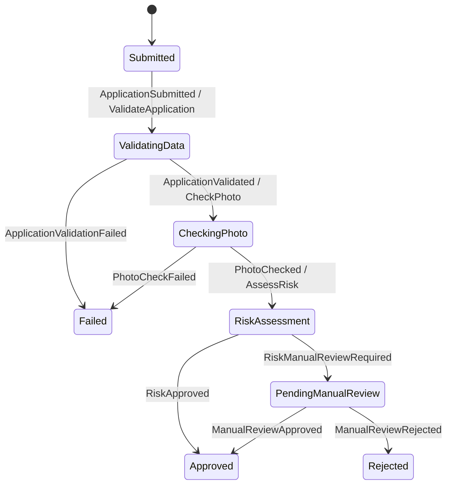

# Driving Licence Onboarding Workflow System

A .NET 8 backend for submitting and processing driving licence applications through an asynchronous onboarding workflow. The system is split into an HTTP API, a background worker, and a shared library, with PostgreSQL persistence and RabbitMQ messaging planned as the workflow infrastructure.

## Solution structure

- `DrivingLicenceWorkflow.Api` — ASP.NET Core Web API
- `DrivingLicenceWorkflow.Worker` — background service host
- `DrivingLicenceWorkflow.Shared` — shared workflow, domain, and persistence components
- `DrivingLicenceWorkflow.Tests` — xUnit tests

## Run with Docker Compose

Copy `.env.example` to `.env` and set local passwords, then start the services:

```powershell
Copy-Item .env.example .env
docker compose up --build
```

Compose starts the API and Worker after PostgreSQL and RabbitMQ are healthy. PostgreSQL creates the `api_user` and `worker_user` roles on the first initialization of its data volume. The API listens at <http://localhost:8080>; Swagger UI is at <http://localhost:8080/swagger>. RabbitMQ management is at <http://localhost:15672> (user `workflow`, password from `RABBITMQ_PASSWORD` in `.env`).

To stop the services, run `docker compose down`. The PostgreSQL data volume is preserved; to reset it, run `docker compose down --volumes`.

## Data model

A single `DrivingLicenceDbContext` (in `DrivingLicenceWorkflow.Shared/Data`) maps every table. The API registers it with the `AppDb` connection string (`api_user`) and the Worker will register the same class with `WorkerDb` (`worker_user`); least privilege is enforced by the PostgreSQL role grants in `docker/postgres/init/01-roles.sql`, not by separate contexts. Table names must stay in sync with those grants.

| Table | Entity | Notes |
|-------|--------|-------|
| `Applications` | `Application` | Applicant data, photo, denormalized `Status`, `RejectionReason`, `PhotoQualityScore`, UTC `CreatedAt`/`UpdatedAt` |
| `AuditTrailEntry` | `AuditTrailEntry` | Append-only transition history; FK to `Applications`; indexed on `(ApplicationId, Timestamp)` |
| `ApplicationWorkflowState` | `ApplicationWorkflowState` | MassTransit saga instance; `CorrelationId` equals the application Id; one-to-one with `Applications` |
| `OutboxMessage`, `OutboxState`, `InboxState` | MassTransit | Transactional outbox / idempotent inbox |

`ApplicationStatus` values are stored as strings. Timestamps are UTC; `DateOfBirth` is a `date`.

### Migrations

One set of migrations lives in `DrivingLicenceWorkflow.Shared/Data/Migrations`. The `dotnet-ef` tool is pinned in `dotnet-tools.json`:

```powershell
dotnet tool restore
dotnet ef migrations add <Name> --project DrivingLicenceWorkflow.Shared --output-dir Data/Migrations
```

The API applies pending migrations in place on startup (`Database.MigrateAsync()`); the Worker does not migrate. Only the API migrates because `api_user` has `CREATE` on the `public` schema and `worker_user` does not.

Trade-offs:

- In-place migration is simple and acceptable for a single instance. With several instances starting at once, they would race on concurrent DDL and could conflict or contend for locks. Production should run migrations from a dedicated job or init container before the app starts, and no instance should migrate at runtime.
- Migrations must stay backward compatible with the previous release: add columns as nullable (or with a safe default) first, and never drop, rename, or narrow columns in the same deployment as the code change.

## Business rules

Three pure services live in `DrivingLicenceWorkflow.Shared/Services`; the shared library lets each host register only what it uses. The API registers `IDataValidationService` for submission validation, while the Worker registers all three services for its workflow consumers. Dates are evaluated against UTC "now" from an injected `TimeProvider`.

| Service | Rules |
|---------|-------|
| `IDataValidationService` | `firstName`, `lastName`, `nationalId`, `phoneNumber`, `address`, `licenceCategory`, `photoBase64` and `email` must be non-empty; `email` must be a plain address (no display name); `dateOfBirth` must be set and the applicant at least `MinApplicantAge` (exactly 18 passes). Errors are prefixed with the field name. |
| `IPhotoCheckService` | Photo must be present, valid base64 (a `data:` URI prefix is accepted), a JPEG or PNG (checked by file signature), at least `MinPhotoFileSizeBytes`, and a quality score of at least `MinPhotoQualityScore` (below it the photo is unacceptable and the workflow fails). The score is `SHA256(photoBytes)[0] % 100`, so the same photo always scores the same. |
| `IRiskAssessmentService` | Manual review is required if the applicant is under `RiskAgeThreshold`, the licence category is not `B`, the national ID is in the watchlist, or the photo quality score is below `PhotoQualityThreshold`. National ID and category comparisons ignore case. The reason lists every rule that triggered. |

### Watchlist

The watchlist is reference data, so it lives in a file rather than in options. `IWatchlistProvider.Contains(nationalId)` is implemented by `FileWatchlistProvider`, which reads the file named by `RiskAssessment:WatchlistPath` once, at construction. The file has one national ID per line; blank lines and lines starting with `#` are ignored, and matching is case-insensitive. The default is `DrivingLicenceWorkflow.Worker/watchlist.txt`, which is copied next to the Worker binaries.

A relative path is resolved against the application directory; an absolute path is used as is. If the file is missing, the Worker fails at startup, because an empty list would silently send nobody to manual review. An empty file is valid. To use your own list in Docker, mount it and point the setting at it, for example `RiskAssessment__WatchlistPath=/data/watchlist.txt` with a volume on the `worker` service. Swapping in a database or API-backed provider only needs a new `IWatchlistProvider` implementation.

The two score settings are deliberately different: a score below `MinPhotoQualityScore` (default 20) fails the photo check, while a score from there up to `PhotoQualityThreshold` (default 50) passes the photo check but sends the application to manual review. Keep `MinPhotoQualityScore` below `PhotoQualityThreshold`, or the risk rule can never trigger.

### Configuration

Each service has its own options class and configuration section. The API and Worker have separate `appsettings.json` files: both need `DataValidation` because both validate the application, while `PhotoCheck` and `RiskAssessment` (including `WatchlistPath`) are Worker-only.

API `appsettings.json`:

```json
{
  "DataValidation": {
    "MinApplicantAge": 18
  }
}
```

Worker `appsettings.json`:

```json
{
  "DataValidation": {
    "MinApplicantAge": 18
  },
  "PhotoCheck": {
    "MinPhotoFileSizeBytes": 1024,
    "MinPhotoQualityScore": 20
  },
  "RiskAssessment": {
    "WatchlistPath": "watchlist.txt",
    "PhotoQualityThreshold": 50,
    "RiskAgeThreshold": 21
  }
}
```

Keep `DataValidation` values consistent between hosts so the API and Worker apply the same age rule. If overriding it, set `DataValidation__MinApplicantAge` on both the `api` and `worker` services in `docker-compose.yml`. Worker-only overrides such as `RiskAssessment__PhotoQualityThreshold=70`, `PhotoCheck__MinPhotoQualityScore=30` and `RiskAssessment__WatchlistPath=/data/watchlist.txt` belong only under the `worker` service.

## Tests

```powershell
dotnet test
```

`DrivingLicenceWorkflow.Tests/BusinessRules` holds the unit tests for the business rule services: data validation, photo check, risk assessment, the file watchlist provider, and the per-host DI registration. Age rules run against a fixed clock (`FakeTimeProvider`, 2026-06-15 UTC) so boundary cases such as "turns 18 today" and leap-day birthdays do not depend on the day the tests run. Photo tests build photos of an exact size and score by varying filler bytes, so size and score boundaries are hit exactly.

## Saga state machine

The Worker orchestrates each application with `ApplicationWorkflowStateMachine`. It defines eight states and nine event-driven transitions:



Handlers are state-specific, so duplicate or out-of-order events cannot rerun a transition or its command. Terminal states are finalized and cannot advance further. Each transition records its event and optional reason through `IAuditService`, which also synchronizes `Application.Status`.

## Step consumers

The Worker registers three MassTransit consumers. Each loads its application from `DrivingLicenceDbContext` using the command's `ApplicationId`, runs the corresponding shared business-rule service, and publishes a result event. Missing applications and unexpected service/contract failures throw so MassTransit can retry or route the message to its error queue rather than silently advancing.

| Consumer | Command | Responsibility | Published event |
|----------|---------|----------------|-----------------|
| `ValidateApplicationConsumer` | `ValidateApplication` | Validates required application data, email, and minimum age with `IDataValidationService`. | `ApplicationValidated` or `ApplicationValidationFailed` with the validation reasons. |
| `CheckPhotoConsumer` | `CheckPhoto` | Checks photo data and quality with `IPhotoCheckService`; persists the accepted quality score on the application for risk assessment. | `PhotoChecked` with the score or `PhotoCheckFailed` with the failure reason. |
| `RiskAssessmentConsumer` | `AssessRisk` | Loads the stored photo score and evaluates the application with `IRiskAssessmentService`. | `RiskApproved` or `RiskManualReviewRequired` with the reason. |

## Message contracts

All 12 messages are C# records in `DrivingLicenceWorkflow.Shared/Messages`. `ApplicationId` is the correlation key: `CorrelationId` is set to that value when `ApplicationSubmitted` creates the saga. Commands are sent to step consumers and are not saga-correlated. Events for an unknown saga are discarded. Events are published; commands are sent to a specific consumer queue.

| Message | Kind | Publisher | Consumer | Extra fields |
|---------|------|-----------|----------|--------------|
| `ApplicationSubmitted` | Event | API | Saga | |
| `ValidateApplication` | Command | Saga | `ValidateApplicationConsumer` | |
| `ApplicationValidated` | Event | `ValidateApplicationConsumer` | Saga | |
| `ApplicationValidationFailed` | Event | `ValidateApplicationConsumer` | Saga | `Reason` |
| `CheckPhoto` | Command | Saga | `CheckPhotoConsumer` | |
| `PhotoChecked` | Event | `CheckPhotoConsumer` | Saga | `QualityScore` |
| `PhotoCheckFailed` | Event | `CheckPhotoConsumer` | Saga | `Reason` |
| `AssessRisk` | Command | Saga | `RiskAssessmentConsumer` | |
| `RiskApproved` | Event | `RiskAssessmentConsumer` | Saga | |
| `RiskManualReviewRequired` | Event | `RiskAssessmentConsumer` | Saga | `Reason` |
| `ManualReviewApproved` | Event | API | Saga | |
| `ManualReviewRejected` | Event | API | Saga | `RejectionReason` |
