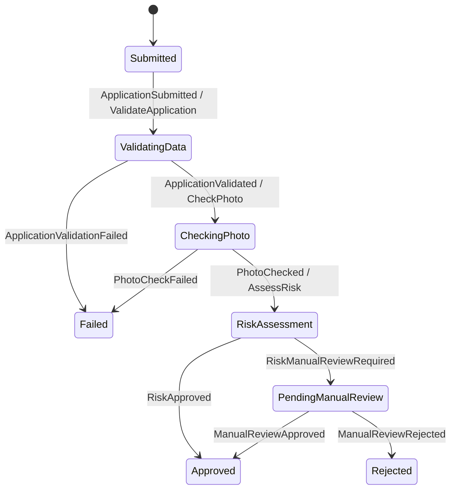

# Driving Licence Onboarding Workflow System

A .NET 8 backend for submitting and processing driving licence applications through an asynchronous onboarding workflow. The system is split into an HTTP API, a background worker, and a shared library, with PostgreSQL persistence and RabbitMQ messaging.

## Solution structure

- `DrivingLicenceWorkflow.Api` — ASP.NET Core Web API
- `DrivingLicenceWorkflow.Worker` — background service host
- `DrivingLicenceWorkflow.Shared` — shared domain, message contracts, services, and persistence components
- `DrivingLicenceWorkflow.Tests` — xUnit tests

The saga state machine is orchestration owned by the Worker. Its source currently resides in Shared as an initial implementation choice; planned relocation inside Worker. The persisted saga state model and message contracts remain in Shared because they are shared with persistence and host boundaries.

## Run with Docker Compose

Copy `.env.example` to `.env` and set local passwords, then start the services:

```powershell
Copy-Item .env.example .env
docker compose up --build
```

Compose starts the API and Worker after PostgreSQL and RabbitMQ are healthy. PostgreSQL creates the `api_user` and `worker_user` roles on the first initialization of its data volume. The API listens at <http://localhost:8080>; Swagger UI is at <http://localhost:8080/swagger>. RabbitMQ management is at <http://localhost:15672> (user `workflow`, password from `RABBITMQ_PASSWORD` in `.env`).

To stop the services, run `docker compose down`. The PostgreSQL data volume is preserved; to reset it, run `docker compose down --volumes`.

## Logging and Swagger

Both hosts use Serilog as their only logging provider. Logs are written as structured JSON, with daily rolling files and 31 retained files. By default, each host writes `logs/app-<date>.log`; Docker Compose mounts these directories on the host as `logs/api` and `logs/worker`. The `logs/` directory is ignored by Git.

Override the path with the `Logging__FilePath` environment variable (for example, `Logging__FilePath=/var/log/driving-licence/app-.log`). The file sink creates the parent directory when needed. API request logs and workflow events include structured application IDs, event names, and state transitions; errors are written with their associated application IDs where available.

Swagger UI is available at <http://localhost:8080/swagger> in all environments. Controller XML comments are included in the generated OpenAPI document.

### Metrics and tracing

The API exposes OpenTelemetry metrics in Prometheus text format at <http://localhost:8080/metrics>. ASP.NET Core instrumentation records the HTTP request-duration histogram (whose sample count provides the request count), and the API adds:

- `driving_licence_applications_submitted_total` — total successful submissions since the API process started.

The Worker has no HTTP endpoint, so it prints metrics with the default console exporter in Development and pushes them over OTLP when `OTEL_EXPORTER_OTLP_ENDPOINT` is set. It records one showcase metric, recorded by the saga on each state transition:

- `driving_licence_workflow_transitions` — transition count, labeled `from` and `to`.

This is a showcase, not a full metric set. Both API and Worker enable EF Core and MassTransit tracing (plus ASP.NET Core on the API). In Development, spans are written by the default OpenTelemetry console exporter. Configure `OTEL_EXPORTER_OTLP_ENDPOINT` to additionally export traces over OTLP to a collector (for example, `http://jaeger:4317` for a Jaeger OTLP receiver). For staging, an optional Jaeger container with OTLP enabled can receive traces from both hosts; the container is intentionally not part of the default Compose setup. Production sampling defaults to 10%.

### Request/response logging

The API uses ASP.NET Core's built-in HTTP logging (`AddPiiMaskedHttpLogging()` and `app.UseHttpLogging()`), so the request and response are written as a single structured log entry: method, path, query string, status code, duration, an allow-listed set of headers (`Content-Type`, `Content-Length`, `Accept`; all others show as `[Redacted]`) and the JSON bodies. Only `application/json` and `application/problem+json` bodies are captured, up to 1 MB each. Swagger paths are not logged. The `Microsoft.AspNetCore.HttpLogging` category is set to `Information` in the Serilog configuration, because the rest of `Microsoft.AspNetCore` is limited to `Warning`.

`PiiMaskingHttpLoggingInterceptor` masks the captured values before they are written, using `PiiMasker` (`DrivingLicenceWorkflow.Api/Logging`): the values of `firstName`, `lastName`, `dateOfBirth`, `nationalId`, `email`, `phoneNumber`, `address` and `photoBase64` become `***`, matched by name, case-insensitively, at any depth in the JSON. Query-string values with those names are masked too. A body that is not valid JSON (including one cut off at the size limit) is replaced with `[unparseable body omitted]` rather than logged unmasked. To mask another field, add its name to `PiiMasker`; free-text fields such as the rejection `reason` are not masked, so do not put personal data in them.

### Worker message logging

`WorkflowMessageObserver` (`DrivingLicenceWorkflow.Worker/Logging`) is registered as a MassTransit consume, publish and send observer. It writes one structured entry for each message consumed, published or sent, with the message type, `MessageId`, `ApplicationId` and, for sends, the destination; consumed messages also log how long the receive took. Faults are logged at `Error` with the exception. Message bodies are never logged. The workflow messages carry only the application ID and short reasons, and applicant data stays in PostgreSQL, so there is no PII to mask on the bus. RabbitMQ itself does not log message payloads in the application logs.
## Data model

A single `DrivingLicenceDbContext` (in `DrivingLicenceWorkflow.Shared/Data`) maps every table. The API registers it with the `AppDb` connection string (`api_user`) and the Worker registers the same class with `WorkerDb` (`worker_user`); least privilege is enforced by the PostgreSQL role grants in `docker/postgres/init/01-roles.sql`, not by separate contexts. The Worker can read application data required by its consumers and update only workflow-owned columns (`Status`, `UpdatedAt`, and `PhotoQualityScore`). Table names must stay in sync with those grants.

The PostgreSQL init script runs only when the data volume is first created. If using a volume initialized before the Worker grants were expanded, apply the corresponding `GRANT SELECT ON "Applications" TO worker_user` and `GRANT UPDATE ("Status", "UpdatedAt", "PhotoQualityScore") ON "Applications" TO worker_user` as the database owner.

| Table | Entity | Notes |
|-------|--------|-------|
| `Applications` | `Application` | Applicant data, photo, denormalized `Status`, `RejectionReason`, `PhotoQualityScore`, UTC `CreatedAt`/`UpdatedAt` |
| `AuditTrailEntry` | `AuditTrailEntry` | Append-only transition history; FK to `Applications`; indexed on `(ApplicationId, Timestamp)` |
| `ApplicationWorkflowState` | `ApplicationWorkflowState` | MassTransit saga instance; `CorrelationId` equals the application Id; one-to-one with `Applications` |
| `OutboxMessage`, `OutboxState`, `InboxState` | MassTransit | Transactional outbox / idempotent inbox |

`ApplicationStatus` values are stored as strings. Timestamps are UTC; `DateOfBirth` is a `date`.

### Migrations

One set of migrations lives in `DrivingLicenceWorkflow.Shared/Data/Migrations`. The `dotnet-ef` tool is pinned in `dotnet-tools.json`:

```powershell
dotnet tool restore
dotnet ef migrations add <Name> --project DrivingLicenceWorkflow.Shared --output-dir Data/Migrations
```

The API applies pending migrations in place on startup (`Database.MigrateAsync()`); the Worker does not migrate. Only the API migrates because `api_user` has `CREATE` on the `public` schema and `worker_user` does not.

Trade-offs:

- In-place migration is simple and acceptable for a single instance. With several instances starting at once, they would race on concurrent DDL and could conflict or contend for locks. Production should run migrations from a dedicated job or init container before the app starts, and no instance should migrate at runtime.
- Migrations must stay backward compatible with the previous release: add columns as nullable (or with a safe default) first, and never drop, rename, or narrow columns in the same deployment as the code change.

## Business rules

Three pure services live in `DrivingLicenceWorkflow.Shared/Services`; the shared library lets each host register only what it uses. The API registers `IDataValidationService` for submission validation, while the Worker registers all three services for its workflow consumers. Dates are evaluated against UTC "now" from an injected `TimeProvider`.

| Service | Rules |
|---------|-------|
| `IDataValidationService` | `firstName`, `lastName`, `nationalId`, `phoneNumber`, `address`, `licenceCategory`, `photoBase64` and `email` must be non-empty; `email` must be a plain address (no display name); `dateOfBirth` must be set and the applicant at least `MinApplicantAge` (exactly 18 passes). Errors are prefixed with the field name. |
| `IPhotoCheckService` | Photo must be present, valid base64 (a `data:` URI prefix is accepted), a JPEG or PNG (checked by file signature), at least `MinPhotoFileSizeBytes`, and a quality score of at least `MinPhotoQualityScore` (below it the photo is unacceptable and the workflow fails). The score is `SHA256(photoBytes)[0] % 100`, so the same photo always scores the same. |
| `IRiskAssessmentService` | Manual review is required if the applicant is under `RiskAgeThreshold`, the licence category is not `B`, the national ID is in the watchlist, or the photo quality score is below `PhotoQualityThreshold`. National ID and category comparisons ignore case. The reason lists every rule that triggered. |

### Watchlist

The watchlist is reference data, so it lives in a file rather than in options. `IWatchlistProvider.Contains(nationalId)` is implemented by `FileWatchlistProvider`, which reads the file named by `RiskAssessment:WatchlistPath` once, at construction. The file has one national ID per line; blank lines and lines starting with `#` are ignored, and matching is case-insensitive. The default is `DrivingLicenceWorkflow.Worker/watchlist.txt`, which is copied next to the Worker binaries.

A relative path is resolved against the application directory; an absolute path is used as is. If the file is missing, the Worker fails at startup, because an empty list would silently send nobody to manual review. An empty file is valid. To use your own list in Docker, mount it and point the setting at it, for example `RiskAssessment__WatchlistPath=/data/watchlist.txt` with a volume on the `worker` service. Swapping in a database or API-backed provider only needs a new `IWatchlistProvider` implementation.

The two score settings are deliberately different: a score below `MinPhotoQualityScore` (default 20) fails the photo check, while a score from there up to `PhotoQualityThreshold` (default 50) passes the photo check but sends the application to manual review. Keep `MinPhotoQualityScore` below `PhotoQualityThreshold`, or the risk rule can never trigger.

### Configuration

Each service has its own options class and configuration section. The API and Worker have separate `appsettings.json` files: both need `DataValidation` because both validate the application, while `PhotoCheck` and `RiskAssessment` (including `WatchlistPath`) are Worker-only.

API `appsettings.json`:

```json
{
  "DataValidation": {
    "MinApplicantAge": 18
  }
}
```

Worker `appsettings.json`:

```json
{
  "DataValidation": {
    "MinApplicantAge": 18
  },
  "PhotoCheck": {
    "MinPhotoFileSizeBytes": 1024,
    "MinPhotoQualityScore": 20
  },
  "RiskAssessment": {
    "WatchlistPath": "watchlist.txt",
    "PhotoQualityThreshold": 50,
    "RiskAgeThreshold": 21
  }
}
```

Keep `DataValidation` values consistent between hosts so the API and Worker apply the same age rule. If overriding it, set `DataValidation__MinApplicantAge` on both the `api` and `worker` services in `docker-compose.yml`. Worker-only overrides such as `RiskAssessment__PhotoQualityThreshold=70`, `PhotoCheck__MinPhotoQualityScore=30` and `RiskAssessment__WatchlistPath=/data/watchlist.txt` belong only under the `worker` service.

## Tests

```powershell
dotnet test
```

`DrivingLicenceWorkflow.Tests/BusinessRules` holds the unit tests for the business rule services: data validation, photo check, risk assessment, the file watchlist provider, and the per-host DI registration. Age rules run against a fixed clock (`FakeTimeProvider`, 2026-06-15 UTC) so boundary cases such as "turns 18 today" and leap-day birthdays do not depend on the day the tests run. Photo tests build photos of an exact size and score by varying filler bytes, so size and score boundaries are hit exactly.

## Saga state machine

The Worker orchestrates each application with `ApplicationWorkflowStateMachine`. It defines eight states and nine event-driven transitions:



Handlers are state-specific, so duplicate or out-of-order events cannot rerun a transition or its command. Terminal states are finalized and cannot advance further. Each transition records its event and optional reason through `IAuditService`, which also synchronizes `Application.Status`.

## Audit trail

The Worker `AuditService` appends one `AuditTrailEntry` for each saga transition, including its UTC timestamp, previous and new statuses, event name, and optional details. It also updates the application's denormalized `Status` and `UpdatedAt`. Both changes are staged on the same scoped `DrivingLicenceDbContext` as saga persistence; the service does not save independently, so the saga repository commits the audit entry, application update, and saga state together. Audit entries are added rather than updated or deleted by the workflow.

## Step consumers

The Worker registers three MassTransit consumers. Each loads its application from `DrivingLicenceDbContext` using the command's `ApplicationId`, runs the corresponding shared business-rule service, and publishes a result event. Missing applications and unexpected service/contract failures throw `WorkflowValidationException` (a permanent error, not retried) so MassTransit routes the message to its error queue rather than silently advancing.

| Consumer | Command | Responsibility | Published event |
|----------|---------|----------------|-----------------|
| `ValidateApplicationConsumer` | `ValidateApplication` | Validates required application data, email, and minimum age with `IDataValidationService`. | `ApplicationValidated` or `ApplicationValidationFailed` with the validation reasons. |
| `CheckPhotoConsumer` | `CheckPhoto` | Checks photo data and quality with `IPhotoCheckService`; persists the accepted quality score on the application for risk assessment. | `PhotoChecked` with the score or `PhotoCheckFailed` with the failure reason. |
| `RiskAssessmentConsumer` | `AssessRisk` | Loads the stored photo score and evaluates the application with `IRiskAssessmentService`. | `RiskApproved` or `RiskManualReviewRequired` with the reason. |

## Messaging and persistence

The API and Worker connect to RabbitMQ using `RabbitMQ__Host`, `RabbitMQ__Username`, and `RabbitMQ__Password` environment variables. Docker Compose points both applications at the `queue` service. The API is a publisher only. It uses MassTransit's EF Core bus outbox so application writes and published submission/manual-review events commit atomically.

The Worker persists saga instances with MassTransit's EF Core repository in PostgreSQL using `ConnectionStrings__WorkerDb`. The saga endpoint and each step-consumer endpoint use the EF Core consume outbox so state/audit changes and outgoing workflow messages are committed together before broker delivery. Commands are sent to the dedicated `validate-application`, `check-photo`, and `assess-risk` queues; saga events are handled by `workflow-saga`.

All Worker endpoints apply exponential retry (five retries, 1-second minimum and 30-second maximum delay) to every exception except `WorkflowValidationException`, which marks permanent missing-data and message-contract failures and is not retried. MassTransit routes exhausted or non-retryable failures to the endpoint's error queue (for example, `workflow-saga_error`). RabbitMQ retains queued messages while the Worker is unavailable.

## Message contracts

All 12 messages are C# records in `DrivingLicenceWorkflow.Shared/Messages`. `ApplicationId` is the correlation key: `CorrelationId` is set to that value when `ApplicationSubmitted` creates the saga. Commands are sent to step consumers and are not saga-correlated. Events for an unknown saga are discarded. Events are published; commands are sent to a specific consumer queue.

| Message | Kind | Publisher | Consumer | Extra fields |
|---------|------|-----------|----------|--------------|
| `ApplicationSubmitted` | Event | API | Saga | |
| `ValidateApplication` | Command | Saga | `ValidateApplicationConsumer` | |
| `ApplicationValidated` | Event | `ValidateApplicationConsumer` | Saga | |
| `ApplicationValidationFailed` | Event | `ValidateApplicationConsumer` | Saga | `Reason` |
| `CheckPhoto` | Command | Saga | `CheckPhotoConsumer` | |
| `PhotoChecked` | Event | `CheckPhotoConsumer` | Saga | `QualityScore` |
| `PhotoCheckFailed` | Event | `CheckPhotoConsumer` | Saga | `Reason` |
| `AssessRisk` | Command | Saga | `RiskAssessmentConsumer` | |
| `RiskApproved` | Event | `RiskAssessmentConsumer` | Saga | |
| `RiskManualReviewRequired` | Event | `RiskAssessmentConsumer` | Saga | `Reason` |
| `ManualReviewApproved` | Event | API | Saga | |
| `ManualReviewRejected` | Event | API | Saga | `RejectionReason` |

## API endpoints

The API is available at `http://localhost:8080`; Swagger UI is served at `/swagger`.

| Method and path | Request | Success response | Other responses |
|-----------------|---------|------------------|-----------------|
| `POST /api/applications` | Applicant fields: `firstName`, `lastName`, `dateOfBirth`, `nationalId`, `email`, `phoneNumber`, `address`, `licenceCategory`, `photoBase64` (base64 string). | `200`: `{ "applicationId": "...", "status": "Submitted" }` | `400`: descriptive field validation errors. |
| `GET /api/applications/{id}` | — | `200`: `id`, `status`, `createdAt`, `updatedAt`. | `404`: application not found. |
| `GET /api/applications/{id}/history` | — | `200`: `{ "entries": [{ "timestamp", "fromStatus", "toStatus", "event", "details" }] }`, oldest first. | `404`: application not found. |
| `POST /api/applications/{id}/approve` | — | `200`: application ID; approval event is queued for the saga. | `404`: application not found; `409`: not awaiting manual review. |
| `POST /api/applications/{id}/reject` | `{ "reason": "..." }` (required, at most 1000 characters). | `200`: application ID; rejection event is queued for the saga. | `400`: invalid reason; `404`: application not found; `409`: not awaiting manual review. |

Submission persists the application and its initial `Submitted` audit entry, then publishes `ApplicationSubmitted` through the EF Core bus outbox in the same `SaveChangesAsync`. Manual-review requests publish events; the saga performs the eventual status and audit updates.
