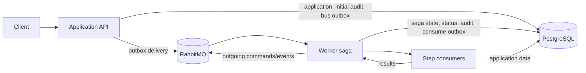
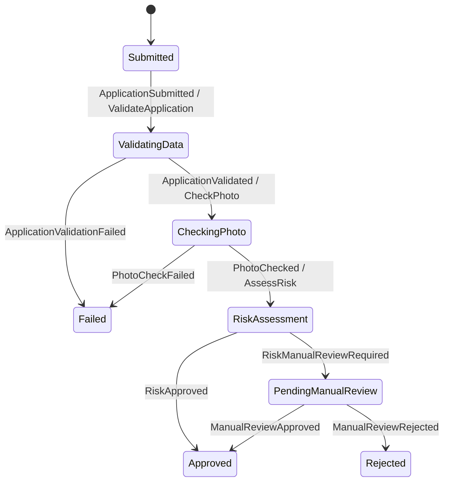

# Driving Licence Onboarding Workflow System

A .NET 8 backend for submitting and processing driving licence applications through an asynchronous onboarding workflow. The system is split into an HTTP API, a background worker, and a shared library, with PostgreSQL persistence and RabbitMQ messaging.

## Solution structure

- `DrivingLicenceWorkflow.Api` — ASP.NET Core Web API
- `DrivingLicenceWorkflow.Worker` — background service host
- `DrivingLicenceWorkflow.Shared` — shared domain, message contracts, services, and persistence components
- `DrivingLicenceWorkflow.Tests` — xUnit tests

## Architecture

The API validates requests, writes applications and their initial audit entries to PostgreSQL, and publishes workflow events through the MassTransit EF Core bus outbox. RabbitMQ carries those events to the Worker, where a MassTransit state-machine saga coordinates the step consumers. The Worker uses the EF Core consume outbox so saga state, application status, audit entries, and outgoing messages are committed together. The API and Worker share the `DrivingLicenceDbContext` type but use separate database credentials.



The workflow uses a MassTransit state-machine saga rather than a bespoke state machine. The Worker owns orchestration at runtime.

## Tests

Run the test suite from the solution directory:

```powershell
dotnet test
```

Tests live in `DrivingLicenceWorkflow.Tests`, organized into `BusinessRules`, `Api`, `Saga`, `Logging`, `Observability`, and `Worker` areas. FsCheck properties run up to 100 generated cases each.

- **Business rules:** age/date validation and photo size, quality-score, and risk-assessment boundaries.
- **API:** controller validation, submission/status/history responses, manual-review approve/reject preconditions, persistence, and published events. These tests use EF Core InMemory and the MassTransit test harness.
- **Saga:** normal approval and manual-review paths, valid state/event transitions, audit trail contents and ordering, and duplicate submission handling while a saga is active. Repeating `ApplicationSubmitted` must not add an audit transition or resend `ValidateApplication`. The tests also cover explicit step failures and unexpected exceptions from validation, photo-check, and risk-assessment consumers; a handled `Fault<T>` records the failure reason and fails the saga without advancing to the next step.
- **Logging, observability, and worker:** tests for logging behavior, workflow metrics, and worker dependency registration, including scoped-service resolution.

The suite uses in-memory persistence and messaging; PostgreSQL/RabbitMQ Testcontainers integration tests are deferred. It therefore does not verify the production database, broker, container startup, or end-to-end recovery behavior.

For manual API checks, open [DrivingLicenceWorkflow.Api.http](./DrivingLicenceWorkflow.Api/DrivingLicenceWorkflow.Api.http) in VS Code and run the requests in order. The default URL targets the API's local HTTP launch profile (`http://localhost:5237`); change `@baseUrl` to `http://localhost:8080` when using Docker Compose. The manual-review requests need the worker running, and the status must reach `PendingManualReview` before choosing either approve or reject.


## Run with Docker Compose

Copy `.env.example` to `.env` and set local passwords, then start the services:

```powershell
Copy-Item .env.example .env
docker compose up --build
```

Compose starts the API and Worker after PostgreSQL and RabbitMQ are healthy. PostgreSQL creates the `api_user` and `worker_user` roles on the first initialization of its data volume. The API listens at <http://localhost:8080>; Swagger UI is at <http://localhost:8080/swagger>. RabbitMQ management is at <http://localhost:15672> (user `workflow`, password from `RABBITMQ_PASSWORD` in `.env`).

To stop the services, run `docker compose down`. The PostgreSQL data volume is preserved; to reset it, run `docker compose down --volumes`.

## Logging and Swagger

Both hosts use Serilog as their only logging provider. Logs are written as structured JSON, with daily rolling files and 31 retained files. By default, each host writes `logs/app-<date>.log`; Docker Compose mounts these directories on the host as `logs/api` and `logs/worker`. The `logs/` directory is ignored by Git.

Override the path with the `Logging__FilePath` environment variable (for example, `Logging__FilePath=/var/log/driving-licence/app-.log`). The file sink creates the parent directory when needed. API request logs and workflow events include structured application IDs, event names, and state transitions; errors are written with their associated application IDs where available.

Swagger UI is available at <http://localhost:8080/swagger> in all environments. Controller XML comments are included in the generated OpenAPI document.

### Metrics and tracing

The API exposes OpenTelemetry metrics in Prometheus text format at <http://localhost:8080/metrics>. ASP.NET Core instrumentation records the HTTP request-duration histogram (whose sample count provides the request count), and the API adds:

- `driving_licence_applications_submitted_total` — total successful submissions since the API process started.

The Worker has no HTTP endpoint, so it prints metrics with the default console exporter in Development and pushes them over OTLP when `OTEL_EXPORTER_OTLP_ENDPOINT` is set. It records one showcase metric, recorded by the saga on each state transition:

- `driving_licence_workflow_transitions` — transition count, labeled `from` and `to`.

This is a showcase, not a full metric set. Both API and Worker enable EF Core and MassTransit tracing (plus ASP.NET Core on the API). In Development, spans are written by the default OpenTelemetry console exporter. Configure `OTEL_EXPORTER_OTLP_ENDPOINT` to additionally export traces over OTLP to a collector (for example, `http://jaeger:4317` for a Jaeger OTLP receiver). For staging, an optional Jaeger container with OTLP enabled can receive traces from both hosts; the container is intentionally not part of the default Compose setup. Production sampling defaults to 10%.

### Request/response logging

The API uses ASP.NET Core's built-in HTTP logging (`AddPiiMaskedHttpLogging()` and `app.UseHttpLogging()`), so the request and response are written as a single structured log entry: method, path, query string, status code, duration, an allow-listed set of headers (`Content-Type`, `Content-Length`, `Accept`; all others show as `[Redacted]`) and the JSON bodies. Only `application/json` and `application/problem+json` bodies are captured, up to 1 MB each. Swagger paths are not logged. The `Microsoft.AspNetCore.HttpLogging` category is set to `Information` in the Serilog configuration, because the rest of `Microsoft.AspNetCore` is limited to `Warning`.

`PiiMaskingHttpLoggingInterceptor` masks the captured values before they are written, using `PiiMasker` (`DrivingLicenceWorkflow.Api/Logging`): the values of `firstName`, `lastName`, `dateOfBirth`, `nationalId`, `email`, `phoneNumber`, `address` and `photoBase64` become `***`, matched by name, case-insensitively, at any depth in the JSON. Query-string values with those names are masked too. A body that is not valid JSON (including one cut off at the size limit) is replaced with `[unparseable body omitted]` rather than logged unmasked. To mask another field, add its name to `PiiMasker`; free-text fields such as the rejection `reason` are not masked, so do not put personal data in them.

### Worker message logging

`WorkflowMessageObserver` (`DrivingLicenceWorkflow.Worker/Logging`) is registered as a MassTransit consume, publish and send observer. It writes one structured entry for each message consumed, published or sent, with the message type, `MessageId`, `ApplicationId` and, for sends, the destination; consumed messages also log how long the receive took. Faults are logged at `Error` with the exception. Message bodies are never logged. The workflow messages carry only the application ID and short reasons, and applicant data stays in PostgreSQL, so there is no PII to mask on the bus. RabbitMQ itself does not log message payloads in the application logs.
## Data model

A single `DrivingLicenceDbContext` (in `DrivingLicenceWorkflow.Shared/Data`) maps every table. The API registers it with the `AppDb` connection string (`api_user`) and the Worker registers the same class with `WorkerDb` (`worker_user`). The grants in `docker/postgres/init/01-roles.sql` restrict the Worker's application-row updates to workflow-owned columns (`Status`, `UpdatedAt`, and `PhotoQualityScore`), but they do not provide complete least privilege: the Worker has `ALL PRIVILEGES` on the audit table and saga/inbox/outbox tables, and `api_user` has schema-level `CREATE` and owns tables created by its migrations. The current grants are a demo safeguard, not a production security boundary. Table names must stay in sync with those grants.

The PostgreSQL init script runs only when the data volume is first created. If using a volume initialized before the Worker grants were expanded, apply the corresponding `GRANT SELECT ON "Applications" TO worker_user` and `GRANT UPDATE ("Status", "UpdatedAt", "PhotoQualityScore") ON "Applications" TO worker_user` as the database owner.

| Table | Entity | Notes |
|-------|--------|-------|
| `Applications` | `Application` | Applicant data, photo, denormalized `Status`, `RejectionReason`, `PhotoQualityScore`, UTC `CreatedAt`/`UpdatedAt` |
| `AuditTrailEntry` | `AuditTrailEntry` | Transition history appended by the workflow; FK to `Applications`; indexed on `(ApplicationId, Timestamp)`. Append-only is an application convention, not enforced by the current Worker database grant. |
| `ApplicationWorkflowState` | `ApplicationWorkflowState` | MassTransit saga instance; `CorrelationId` equals the application Id; one-to-one with `Applications` |
| `OutboxMessage`, `OutboxState`, `InboxState` | MassTransit | Transactional outbox / idempotent inbox |

`ApplicationStatus` values are stored as strings. Timestamps are UTC; `DateOfBirth` is a `date`.

### Migrations

One set of migrations lives in `DrivingLicenceWorkflow.Shared/Data/Migrations`. The `dotnet-ef` tool is pinned in `dotnet-tools.json`:

```powershell
dotnet tool restore
dotnet ef migrations add <Name> --project DrivingLicenceWorkflow.Shared --output-dir Data/Migrations
```

The API applies pending migrations in place on startup (`Database.MigrateAsync()`); the Worker does not migrate. Only the API migrates because `api_user` has `CREATE` on the `public` schema and `worker_user` does not.

Trade-offs:

- In-place migration is simple and acceptable for a single instance. With several instances starting at once, they would race on concurrent DDL and could conflict or contend for locks. Production should run migrations from a dedicated job or init container before the app starts, and no instance should migrate at runtime.
- Migrations must stay backward compatible with the previous release: add columns as nullable (or with a safe default) first, and never drop, rename, or narrow columns in the same deployment as the code change.

## Business rules

Three pure services live in `DrivingLicenceWorkflow.Shared/Services`; the shared library lets each host register only what it uses. The API registers `IDataValidationService` for submission validation, while the Worker registers all three services for its workflow consumers. Dates are evaluated against UTC "now" from an injected `TimeProvider`.

| Service | Rules |
|---------|-------|
| `IDataValidationService` | `firstName`, `lastName`, `nationalId`, `phoneNumber`, `address`, `licenceCategory`, `photoBase64` and `email` must be non-empty; `email` must be a plain address (no display name); `dateOfBirth` must be set and the applicant at least `MinApplicantAge` (exactly 18 passes). Errors are prefixed with the field name. |
| `IPhotoCheckService` | Photo must be present, valid base64 (a `data:` URI prefix is accepted), a JPEG or PNG (checked by file signature), at least `MinPhotoFileSizeBytes`, and a quality score of at least `MinPhotoQualityScore` (below it the photo is unacceptable and the workflow fails). The score is `SHA256(photoBytes)[0] % 100`, so the same photo always scores the same. |
| `IRiskAssessmentService` | Manual review is required if the applicant is under `RiskAgeThreshold`, the licence category is not `B`, the national ID is in the watchlist, or the photo quality score is below `PhotoQualityThreshold`. National ID and category comparisons ignore case. The reason lists every rule that triggered. |

### Watchlist

The watchlist is reference data, so it lives in a file rather than in options. `IWatchlistProvider.Contains(nationalId)` is implemented by `FileWatchlistProvider`, which reads the file named by `RiskAssessment:WatchlistPath` once, at construction. The file has one national ID per line; blank lines and lines starting with `#` are ignored, and matching is case-insensitive. The default is `DrivingLicenceWorkflow.Worker/watchlist.txt`, which is copied next to the Worker binaries.

A relative path is resolved against the application directory; an absolute path is used as is. If the file is missing, the Worker fails at startup, because an empty list would silently send nobody to manual review. An empty file is valid. To use your own list in Docker, mount it and point the setting at it, for example `RiskAssessment__WatchlistPath=/data/watchlist.txt` with a volume on the `worker` service. Swapping in a database or API-backed provider only needs a new `IWatchlistProvider` implementation.

The two score settings are deliberately different: a score below `MinPhotoQualityScore` (default 20) fails the photo check, while a score from there up to `PhotoQualityThreshold` (default 50) passes the photo check but sends the application to manual review. Keep `MinPhotoQualityScore` below `PhotoQualityThreshold`, or the risk rule can never trigger.

### Configuration

Each service has its own options class and configuration section. The API and Worker have separate `appsettings.json` files: both need `DataValidation` because both validate the application, while `PhotoCheck` and `RiskAssessment` (including `WatchlistPath`) are Worker-only.

API `appsettings.json`:

```json
{
  "DataValidation": {
    "MinApplicantAge": 18
  }
}
```

Worker `appsettings.json`:

```json
{
  "DataValidation": {
    "MinApplicantAge": 18
  },
  "PhotoCheck": {
    "MinPhotoFileSizeBytes": 1024,
    "MinPhotoQualityScore": 20
  },
  "RiskAssessment": {
    "WatchlistPath": "watchlist.txt",
    "PhotoQualityThreshold": 50,
    "RiskAgeThreshold": 21
  }
}
```

Keep `DataValidation` values consistent between hosts so the API and Worker apply the same age rule. If overriding it, set `DataValidation__MinApplicantAge` on both the `api` and `worker` services in `docker-compose.yml`. Worker-only overrides such as `RiskAssessment__PhotoQualityThreshold=70`, `PhotoCheck__MinPhotoQualityScore=30` and `RiskAssessment__WatchlistPath=/data/watchlist.txt` belong only under the `worker` service.

## Saga state machine

The Worker orchestrates each application with `ApplicationWorkflowStateMachine`. It defines eight states and nine event-driven transitions:



Handlers are state-specific. A repeated `ApplicationSubmitted` received while the saga is active is explicitly ignored; other events that do not match the current state are not treated as successful transitions and can fault into the endpoint error queue. Terminal states are finalized and their saga rows are deleted. This means a late event for a deleted saga is not guaranteed to be discarded, and a fresh `ApplicationSubmitted` for a terminal application can create a new saga. Do not treat finalization as protection against replay. Each accepted transition records its event and optional reason through `IAuditService`, which also synchronizes `Application.Status`.

## Audit trail

The Worker `AuditService` appends one `AuditTrailEntry` for each saga transition, including its UTC timestamp, previous and new statuses, event name, and optional details. It also updates the application's denormalized `Status` and `UpdatedAt`. The state machine attaches a `WorkflowAuditActivity` to each transition; the activity calls the audit service. Both changes are staged on the same scoped `DrivingLicenceDbContext` as saga persistence; the service does not save independently, so the consume outbox commits the audit entry, application update, and saga state together. Audit entries are added rather than updated or deleted by the workflow. A general MassTransit pipeline observer or filter for automatic audit detection is a documented alternative, not the implementation used here.

## Step consumers

The Worker registers three MassTransit consumers. Each loads its application from `DrivingLicenceDbContext` using the command's `ApplicationId`, runs the corresponding shared business-rule service, and publishes a result event. Missing applications and unexpected service/contract failures throw `WorkflowValidationException` (a permanent error, not retried) so MassTransit routes the message to its error queue rather than silently advancing.

| Consumer | Command | Responsibility | Published event |
|----------|---------|----------------|-----------------|
| `ValidateApplicationConsumer` | `ValidateApplication` | Validates required application data, email, and minimum age with `IDataValidationService`. | `ApplicationValidated` or `ApplicationValidationFailed` with the validation reasons. |
| `CheckPhotoConsumer` | `CheckPhoto` | Checks photo data and quality with `IPhotoCheckService`; persists the accepted quality score on the application for risk assessment. | `PhotoChecked` with the score or `PhotoCheckFailed` with the failure reason. |
| `RiskAssessmentConsumer` | `AssessRisk` | Loads the stored photo score and evaluates the application with `IRiskAssessmentService`. | `RiskApproved` or `RiskManualReviewRequired` with the reason. |

## Messaging and persistence

The API and Worker connect to RabbitMQ using `RabbitMQ__Host`, `RabbitMQ__Username`, and `RabbitMQ__Password` environment variables. Docker Compose points both applications at the `queue` service. The API is a publisher only. It uses MassTransit's EF Core bus outbox so application writes and published submission/manual-review events commit atomically.

The Worker persists saga instances with MassTransit's EF Core repository in PostgreSQL using `ConnectionStrings__WorkerDb`. The saga endpoint and each step-consumer endpoint use the EF Core consume outbox so state/audit changes and outgoing workflow messages are committed together before broker delivery. Commands are sent to the dedicated `validate-application`, `check-photo`, and `assess-risk` queues; saga events are handled by `workflow-saga`.

All Worker endpoints apply exponential in-process retry (five retries, 1-second minimum and 30-second maximum delay) to exceptions other than `WorkflowValidationException`, which marks a permanent missing-data or message-contract failure and is not retried. A failed step publishes a MassTransit `Fault<T>` event. When the saga successfully consumes a fault for its current step, it records the fault reason in the audit history and moves the application to `Failed`. Messages whose retries are exhausted, or that cannot be handled by their endpoint, are also routed to that endpoint's error queue (for example, `workflow-saga_error`). If the fault event cannot be processed, the application may remain in an intermediate status while the message is in an error queue. No automated error-queue replay tool or operator runbook is included. RabbitMQ retains queued messages while the Worker is unavailable; this does not by itself guarantee that every error-queue message is safe to replay.

### Delivery, duplicates, and recovery

The API's EF Core bus outbox stores the application update and outgoing event together. If the API stops after committing but before sending, the outbox can deliver the event when the service resumes. On Worker endpoints, the EF Core consume outbox commits saga state, audit/status changes, and outgoing messages together. If a Worker crashes before that transaction commits, the transaction rolls back and RabbitMQ can redeliver the message. If it crashes after commit but before acknowledging the delivery, the inbox recognizes the already-processed `MessageId` during its duplicate-detection window and prevents the same delivery from repeating its effects.

This protection is message-ID deduplication, not general business-level idempotency. A newly published message with the same application ID has a different `MessageId`. Repeated `ApplicationSubmitted` messages are ignored while the saga is active, but a replay after finalization can create a new saga because finalization removes the saga row. That new saga can move an already terminal application's status back to `ValidatingData` and restart processing. Unknown-saga and other out-of-state events are not configured for automatic discard; depending on the event and state, they can be retried and routed to an error queue.

There is no automated dead-letter/error-queue replay procedure in this project. Before any manual recovery, inspect the endpoint's error message, application status, audit history, and saga state; establish whether the original transaction committed and whether the application is terminal. Do not blindly shovel messages back to the live queue: a replayed submission can restart a finalized application, while a late event can be unprocessable. A production deployment should provide an authenticated, audited recovery process with explicit replay safeguards.

Manual approve/reject requests first read the application's current status and then publish an event through the outbox. The check and publish are not an atomic compare-and-set: concurrent reviewers can both receive `200`, even though only one event can advance the saga. Clients should read the resulting status/history rather than interpret the response as proof that their decision won. This race needs an atomic state-claim or equivalent coordination before production use.

## Message contracts

All 12 messages are C# records in `DrivingLicenceWorkflow.Shared/Messages`. `ApplicationId` is the correlation key: `CorrelationId` is set to that value when `ApplicationSubmitted` creates the saga. Commands are sent to step consumers and are not saga-correlated. Events are published; commands are sent to a specific consumer queue. Missing-instance behavior is not configured to discard events: an event for a saga that no longer exists can fault and be routed to the saga endpoint's error queue. The exception is a fresh `ApplicationSubmitted`, which can create a new saga in the initial state.

| Message | Kind | Publisher | Consumer | Extra fields |
|---------|------|-----------|----------|--------------|
| `ApplicationSubmitted` | Event | API | Saga | |
| `ValidateApplication` | Command | Saga | `ValidateApplicationConsumer` | |
| `ApplicationValidated` | Event | `ValidateApplicationConsumer` | Saga | |
| `ApplicationValidationFailed` | Event | `ValidateApplicationConsumer` | Saga | `Reason` |
| `CheckPhoto` | Command | Saga | `CheckPhotoConsumer` | |
| `PhotoChecked` | Event | `CheckPhotoConsumer` | Saga | `QualityScore` |
| `PhotoCheckFailed` | Event | `CheckPhotoConsumer` | Saga | `Reason` |
| `AssessRisk` | Command | Saga | `RiskAssessmentConsumer` | |
| `RiskApproved` | Event | `RiskAssessmentConsumer` | Saga | |
| `RiskManualReviewRequired` | Event | `RiskAssessmentConsumer` | Saga | `Reason` |
| `ManualReviewApproved` | Event | API | Saga | |
| `ManualReviewRejected` | Event | API | Saga | `RejectionReason` |

## API endpoints

The API is available at `http://localhost:8080`; Swagger UI is served at `/swagger`.

| Method and path | Request | Success response | Other responses |
|-----------------|---------|------------------|-----------------|
| `POST /api/applications` | Applicant fields: `firstName`, `lastName`, `dateOfBirth`, `nationalId`, `email`, `phoneNumber`, `address`, `licenceCategory`, `photoBase64` (base64 string). | `200`: `{ "applicationId": "...", "status": "Submitted" }` | `400`: descriptive field validation errors. |
| `GET /api/applications/{id}` | — | `200`: `id`, `status`, `createdAt`, `updatedAt`. | `404`: application not found. |
| `GET /api/applications/{id}/history` | — | `200`: `{ "entries": [{ "timestamp", "fromStatus", "toStatus", "event", "details" }] }`, oldest first. | `404`: application not found. |
| `POST /api/applications/{id}/approve` | — | `200`: application ID; approval event is queued for the saga. | `404`: application not found; `409`: not awaiting manual review. |
| `POST /api/applications/{id}/reject` | `{ "reason": "..." }` (required, at most 1000 characters). | `200`: application ID; rejection event is queued for the saga. | `400`: invalid reason; `404`: application not found; `409`: not awaiting manual review. |

Submission persists the application and its initial `Submitted` audit entry, then publishes `ApplicationSubmitted` through the EF Core bus outbox in the same `SaveChangesAsync`. Manual-review requests publish events; the saga performs the eventual status and audit updates.

## Documented stretch enhancements

These are optional approaches from the design, not capabilities currently provided by the application:

| Enhancement | Current status |
|-------------|----------------|
| `X-Idempotency-Key` on submission | Not implemented; the API does not inspect this header, so retrying the HTTP submission can create another application. The inbox and active-saga duplicate guard cover message delivery, not API-level deduplication by client key. A cache could provide short-lived key-to-response mapping; a shared store such as Redis is needed across production instances. |
| Audit via pipeline observer/filter | Not implemented; transitions explicitly attach `WorkflowAuditActivity`. A pipeline observer/filter could centralize transition auditing, but would add indirection and must preserve the saga transaction. |
| PostgreSQL/RabbitMQ Testcontainers | Deferred. The current tests use in-memory persistence and messaging; see [Tests](#tests). |
| Manual-review authentication | Not implemented; approve/reject endpoints have no authentication or reviewer identity. See [Assumptions and shortcuts](#assumptions-and-shortcuts). |
| Synchronous manual-review decision claim | Not implemented; atomically change `PendingManualReview` to an intermediate `ReviewSubmitted` status, add an audit entry, and publish the final decision through the outbox in the same database transaction. Use a conditional update that succeeds only while the application is still pending review, so exactly one concurrent reviewer wins; return a conflict to the loser. The saga then applies the final `Approved` or `Rejected` status asynchronously. |
| JSON workflow definition | Not implemented; states and transitions are compiled into `ApplicationWorkflowStateMachine`. Supporting JSON would require schema validation and applying the configured definition at startup. |

## Assumptions and shortcuts

- The API and Worker validate the same application data independently. Their `DataValidation` settings must remain aligned; otherwise an application accepted by the API may fail later in the Worker.
- Request validation does not mirror every database column length. Overlong applicant fields may pass request validation and fail during persistence instead of returning a field-level `400`.
- Photos are accepted as base64 in the request and stored in PostgreSQL for this assessment. The quality score is a deterministic SHA-256-based demonstration rule, not an image-quality or identity-verification model.
- The API applies EF migrations at startup. This is intended for a single local instance, not concurrent production instances.
- Manual review has no authentication or reviewer identity recorded in the audit trail. The endpoints are suitable only for a trusted local/demo environment.
- Retry policy is in-process; there is no delayed redelivery policy or built-in error-queue recovery workflow.
- The test suite uses in-memory persistence and a test harness rather than real PostgreSQL/RabbitMQ integration tests.
- Compose runs the API and Worker in `Development`; Swagger, metrics, and development-oriented telemetry settings should not be exposed unchanged in a production deployment.

## Photo storage trade-offs

Storing base64 photo data in a PostgreSQL `text` column keeps the assessment simple: the application and its photo are saved together, and consumers can process the same persisted record without a separate storage dependency. The trade-off is that base64 increases payload size, large values enlarge database backups and routine queries if they load full application entities, and database access now also grants access to sensitive identity imagery. The current solution is not a production photo-storage design and does not provide a complete retention or deletion policy.

For production, accept bounded uploads, validate the file type and size, and store the image in private object storage rather than in the application row. Persist an opaque object key and relevant metadata (such as content type, size, checksum, and retention expiry) in PostgreSQL. Apply encryption, least-privilege access, short-lived access mechanisms, malware/content checks appropriate to the threat model, and a documented deletion/retention policy. Keep only the data needed by the workflow in database queries and messages.

## AI assistance

AI-assisted tools were used during research, planning and implementation. They supported specification and code work; the submitted implementation and its tests remain the author's responsibility. The repository's `.kiro/` specification and `AGENTS.md` are planning/development artifacts, not proof that every listed requirement or test was completed. The actual test coverage is described above; generated or planned work should not be treated as verified unless it is present in the code and passes the relevant tests. Total AI tooling cost is calculated at 10€.

## Production improvements

Before production use, prioritize:

1. Retain terminal saga identity or add a durable status guard so replayed submissions cannot restart approved, rejected, or failed applications. Define explicit behavior for late and out-of-order events.
2. Mirror database length constraints in request validation and return consistent `ProblemDetails` for persistence errors. Make manual decisions atomic and auditable: claim the pending-review state once, return a response that reflects asynchronous acceptance, and record the authenticated reviewer/actor.
3. Add an authenticated and monitored recovery process for error queues, plus delayed redelivery for transient infrastructure failures. Document safe replay and ensure recovery cannot bypass current application state.
4. Move photos to private object storage with request size limits, content validation, encryption, access controls, and retention/deletion handling.
5. Run migrations with a dedicated role/job, tighten audit-table permissions, configure production environment settings, protect or disable Swagger/metrics, restrict management ports, and add health/readiness checks and operational alerts.
6. Add integration tests against PostgreSQL and RabbitMQ for outbox/inbox behavior, concurrent manual-review requests, migrations, fault routing, and restart/recovery scenarios.
7. Aggregate structured logs in a centralized logging platform with appropriate access controls, retention, and alerting; the current file sink is local/container-oriented.
8. Store and rotate production credentials in a secrets manager rather than relying on local `.env` files.
